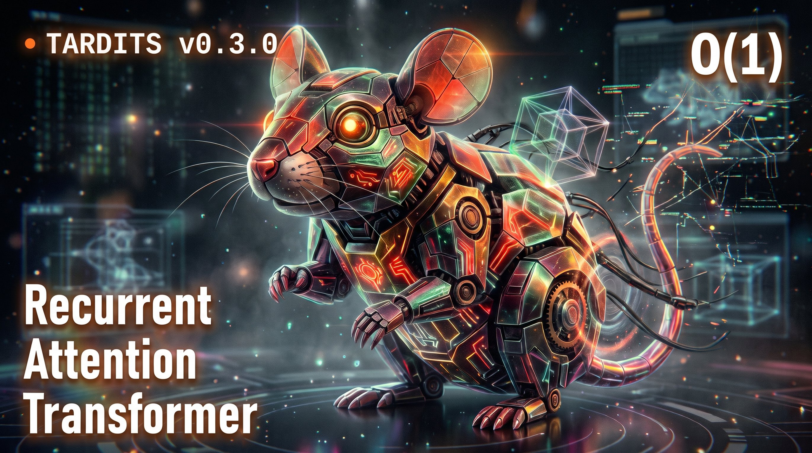
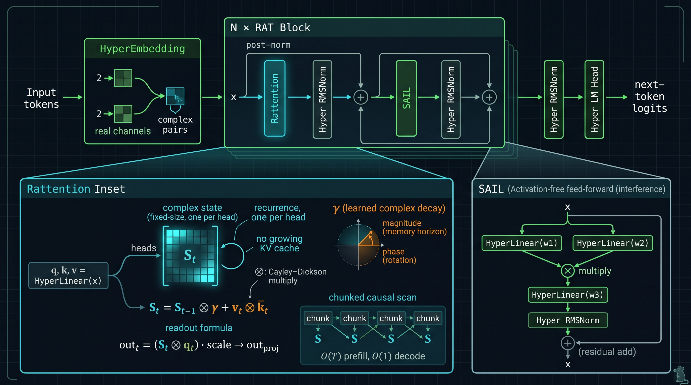
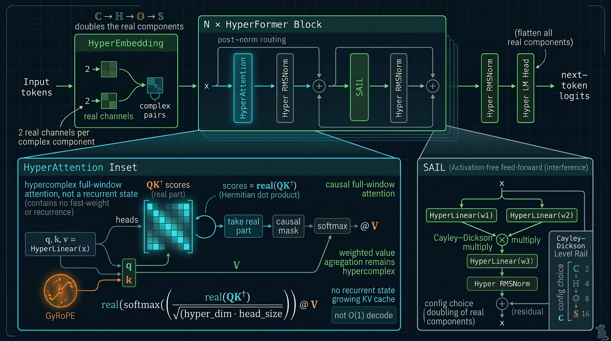
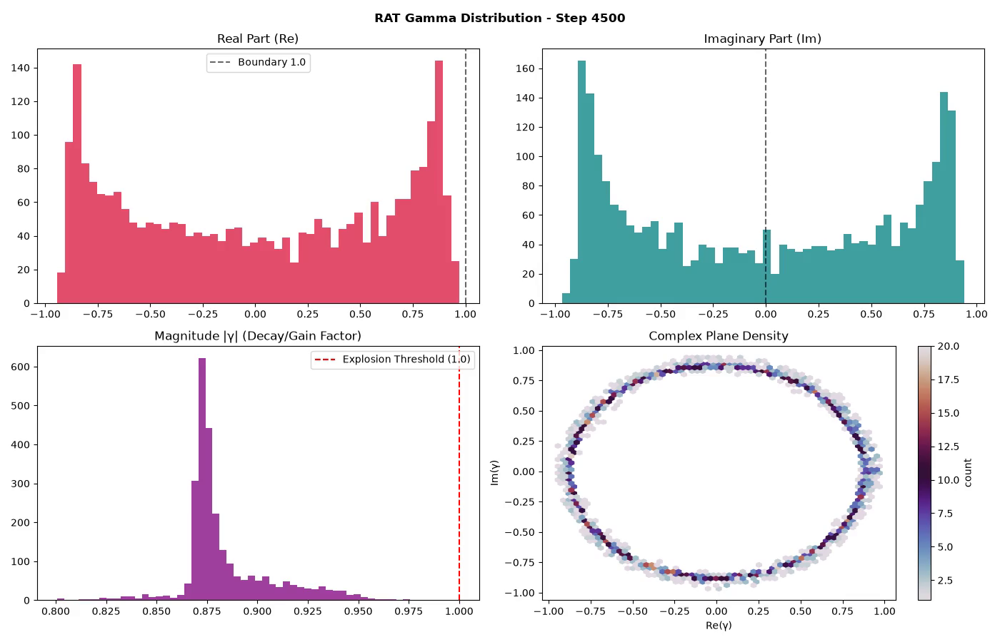
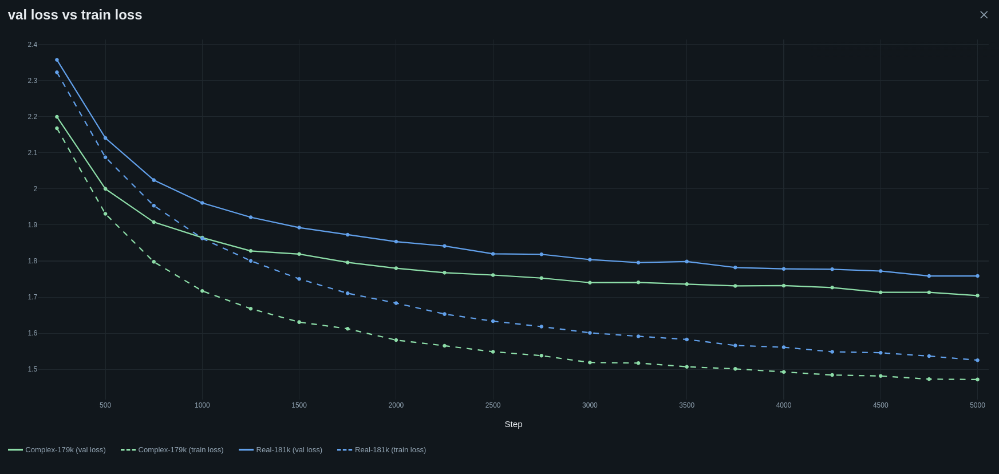
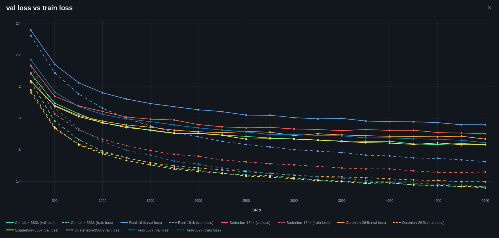
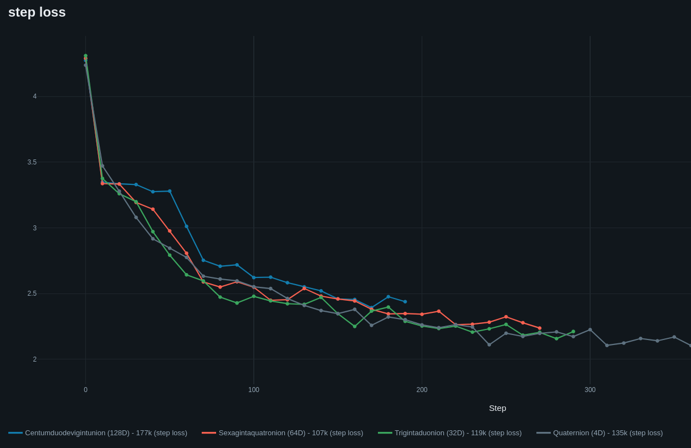

<div align="center">
  
# Text And Rotating Dimensions In Token Space<br><sup><small>*čili: jak udělat LM větší zevnitř*</small></sup>

🇬🇧 [English](README.md) | 🇩🇪 [Deutsch](README.de.md) | 🇨🇿 **Čeština** | 🇨🇳 [中文](README.zh.md) | 🇷🇺 [Русский](README.ru.md)

<a href="https://git.pvlb.dev/ml-lab/tardits"> Hlavní repo - https://git.pvlb.dev/ml-lab/tardits</a><br>
<small><GitHub mirror: <a href="https://github.com/pvlb-dev/tardits" target="_blank">https://github.com/pvlb-dev/tardits</a>></small>

> Toto je český překlad pro v0.3.0. Kanonickým zdrojem je anglický [README.md](README.md); při jakémkoli rozporu platí anglické znění.

---

</div>
<br>


### Vítejte v **TARDITS**, malé laboratoři pro jazykové modely s komplexními hodnotami!

**v0.3.0 přidává RAT** - *Recurrent Attention Transformer*: softmax pozornost je
nahrazena lineární fast-weight pamětí s naučeným komplexním útlumem. Stav má
pevnou velikost, generování je O(1) na token a KV cache neroste. Je to jiný
kompromis, nikoli něco zadarmo: při vyladěném LR se **RAT33 s o 31 % menším
počtem parametrů vyrovná 48M RealGPT v průměrné validační ztrátě na FineWebu** a
RAT je mnohem rychlejší při dekódování dlouhého kontextu. Oba stále mají jasné
limity v retrievalu a interpretovatelnosti. Poctivé výsledky, včetně těch
negativních (null), jsou odkazovány níže.

<p align="center">

</p>

> Tabulku důkazů pro v0.3.0 a poctivě popsané limity najdete v
> [docs/index.md](docs/index.md). Běhy na FineWeb, opakovaný běh s opraveným
> pořadím dat a srovnání RAT vs. Real nahrazují starý příběh postavený pouze na
> Shakespearovi. Další dokumentace k RAT/HyperFormer a větší běhy jsou na cestě;
> toto vydání je startovní bod, nikoli poslední slovo.


<details>
<summary><b>Jak to začalo</b> - příběh v0.0.0 🔻</summary>

<br>

TARDITS vznikl jako moje pojetí skvělého tutoriálu
[Let's build GPT](https://youtu.be/kCc8FmEb1nY?si=I0z2-jByJj_6_QIH). Když jsem
dokončil svůj GPT-net a vylepšil ho (RoPE, SwiGLU, RMSNorm...), dostal jsem nápad
napsat komplexní transformer. Hlavně proto, že jsem si položil otázku, jestli
*opravdu* potřebují aktivační funkci... ukázalo se, že **nepotřebují 🤯**

Po několika iteracích se $\mathbb{C}$-net ukázal překvapivě stabilní. Samozřejmě
jsem pak musel zkusit kvaterniony ($\mathbb{H}$). Byly postavené pomocí
Cayley-Dicksonovy konstrukce - takže transformerem proženu 2 komplexní hodnoty a
všechnu práci s backpropem nechám na PyTorch. Pak koncept trochu eskaloval a
nějak vznikly i sítě pro oktaniony ($\mathbb{O}$) a sedeniony ($\mathbb{S}$). Obě
fungují, ale trénink trvá opravdu dlouho. Hlavně na CPU :D

Pro CVNN možná existují lepší využití než predikce textu... ale proč ne
Shakespeare?

</details>

---

<br>


## 🙃 Architektura
<details>
<summary><b>Klikněte pro rozbalení 🔻</b></summary>

### 🐀 v0.3.0 - RAT (aktuální)

<p align="center">

</p>

*Blok RAT. `Rattention` udržuje komplexní fast-weight stav s pevnou velikostí a
naučeným útlumem `γ`; `SAIL` je feed-forward cesta bez aktivace.*

RAT nahrazuje softmax/KV cestu lineární fast-weight pamětí:

```
S_t = S_{t-1} ⊗ gamma + v_t ⊗ conjugate(k_t)
out_t = (S_t ⊗ q_t) * scale -> out_proj
```

`gamma` se učí pro každý prvek stavu; její velikost je horizont paměti a její
fáze rotuje asociace. Jde o prototyp `LinA` integrovaný do `tardits`.

**Čím je výjimečný**

- **Stav pevné velikosti:** dekódování je O(1) na token a KV cache neroste;
  prefill je O(T) s chunkovaným kauzálním skenem.
- **Paměť a pozice v jednom parametru:** komplexní útlum nese jak horizont
  zapomínání, tak relativní fázi; žádná samostatná tabulka absolutních pozic.
- **Bez aktivace:** stejný blok SAIL a hyperkomplexní embedding fungují bez
  aktivace v MLP.
- **Poctivé limity:** při 11M-45M parametrech je RAT konkurenceschopný na FineWeb
  a mnohem rychlejší při dlouhém dekódování. NIAH/retrieval je čistý null pro
  **RAT i RealGPT** při současných velikostech; škálování a lepší NIAH testy
  jsou v běhu. Trigger/gating sondy jsou výzkumné poznámky, ne schopnosti.

### 🧬 v0.2.0 - HyperFormer

<p align="center">

</p>

*Blok HyperFormer. GyRoPE rotuje q/k, skóre používají reálnou část
Hermitovského součinu a váhy pozornosti zůstávají reálné, zatímco hodnoty
zůstávají hyperkomplexní.*

HyperFormer je předchůdce a obecná hyperkomplexní cesta: stejný blok se
instancuje na Cayley-Dicksonových úrovních ℂ, ℍ, 𝕆 a 𝕊. Zachovává kauzální
pozornost přes celé okno (v současné implementaci bez KV cache, bez nároku na
O(1) dekódování), používá GyRoPE pro pozici a bere reálnou část `QK†` jako
softmax skóre.

### 🧩 Moduly

#### ⛵ SAIL (Self-Activating Interference Layer)
Ve standardních $\mathbb{R}$-netech jsou nelineární aktivační funkce ve
feed-forward vrstvě striktně nutné. Komplexní lineární vrstva je pořád lineární;
nelinearita v **SAIL** vzniká násobením **dvou projekcí stejného vstupu**:
`SAIL(z) = (W₁z) ⊗ (W₂z)`, což je kvadratické. V podstatě jde o SwiGLU bez
„Swi": rozdělení dvěma lineárními vrstvami, hyperkomplexní násobení a pak
projekce. V kombinaci s reziduálními spojeními `z = z + SAIL(z)` to stačí pro
trénovatelný komplexní transformer.

#### 🪢 GyRoPE - naučitelný RoPE, plný kruh
Při ~~implementaci~~ experimentování s RoPE ve svém $\mathbb{R}$-netu jsem
zjistil, že naučitelný RoPE inicializovaný náhodně od $-2\pi$ do $2\pi$ odpovídal
klasickým pozičním kódováním. S komplexními transformery funguje pěkně, i když
je těch vah málo a mění se pomalu.

* $\mathbb{C}$-RoPE rotuje v komplexní rovině $2\mathcal{D}$.
* $\mathbb{H}$-RoPE rotuje kolem jednotkové 3-sféry ($S^3$).
* $\mathbb{O}$ a $\mathbb{S}$ rotují kolem svých příslušných hypersférických protějšků.

#### 👀 HyperAttention
Jak se v komplexních prostorech směruje pozornost? **Vyhrává jednoduchost.**
Skóre používají Hermitovský skalární součin ($Q K^\dagger$); vezme se pouze
**reálná složka**, použije se kauzální maska a standardní softmax:

```python
# In C-Space:
wei = (q @ k.adjoint()) * (2 * self.head_size) ** -0.5
wei = wei.real
wei = F.softmax(wei.masked_fill(self.tril[:T, :T] == 0, float("-inf")), dim=-1)
# Weighted value aggregation remains hypercomplex:
out = wei.to(v.dtype) @ v
```

Reálná část zachycuje fázové sladění a velikost a chová se jako skalární skóre
afinity; reálné váhy pak škálují plné hyperkomplexní vektory hodnot.

#### 🐀 Rattention
`Rattention` je lineární fast-weight modul: q/k/v projekce, komplexní stav pro
každou hlavu, `S_t = S_{t-1} ⊗ γ + v_t ⊗ k̄_t` a čtení `(S_t ⊗ q_t)·scale`.
`forward` (trénink) a rekurentní `step` (generování) jsou vzájemně kontrolovány
testy.

#### 🏋️ Inicializace vah
Váhy pozornosti a SAIL se inicializují kolem jednotkové kružnice/koule a škálují se:

$$\sqrt{\frac{S}{d_{in} + d_{out}}}$$

kde $S$ je $\mathbb{C}=1.0$, $\mathbb{H}=0.5$, $\mathbb{O}=0.25$, $\mathbb{S}=0.125$.

#### 🛌 Embedding & LM-Head
Tokeny se mapují do komplexního hyperkomplexního tenzoru s jednou dvojicí
reálné/imaginární složky na každou komplexní komponentu; LM head zploští všechny
reálné/imaginární komponenty zpět na $\mathbb{R}$ logity.

#### 🛡️ RMSNorm - normalizace amplitud se zachováním fází
🧨 odstraňte při explodujícím šumu transformeru (NaN) 💥

Standardní normalizace může v komplexních prostorech deformovat geometrickou
informaci o fázi. Vlastní **RMSNorm** počítá RMS z velikostí vektorů
($\Vert q\Vert^2 = |z_1|^2 + |z_2|^2$) a přeškálovává amplitudy, přičemž fáze
zůstávají nedotčené.

<br>
<br>

</details>

## 🔥 Žhavé křivky (benchmarky a výsledky)
<details>
<summary><b>Klikněte pro rozbalení 🔻</b></summary>

<br>

### 🌊 Interferenční vzory SAIL ($\mathbb{C}$)

#### 🎬 Vývoj 2D interference SAIL
[](https://www.youtube.com/watch?v=nFiWQWMtX-Q)
[](https://youtube.com/shorts/OIvpBzp8Y8c?si=LPVmYf6Skw9IRELd)

#### 🎬 3D topografie fáze a amplitudy SAIL
[](https://youtu.be/r6ykSiY3ipY?si=VosKe4IpfWTy1jbz)
[](https://youtube.com/shorts/7kjrDF7-UUg?si=jcLONq29jUDC2mVX)

*Obrázek: Vývoj selektivní fázové interference napříč všemi 8 vrstvami Transformeru během tréninkových kroků. Hluboké vrstvy (6 a 7) vykazují extrémní destruktivní fázové rušení spolu s ostře vyhraněnými rezonančními špičkami (amplituda > 10,000). Proto zde design Post-Norm dává velký smysl*

<br>

### 🧪 FineWeb - RAT vs RealGPT

Znakový FineWeb, 90.1M znaků na jednu větev, block 1024, batch 4. Řádky mají 22k
iterací, pokud není uvedeno jinak; všechny používají opravu pořadí dat. Řádky
RAT L1 byly trénovány se stabilním skenem #23.

| model | lr | kroky | parametry | znaky/param | val loss | poznámka |
|---|---:|---:|---:|---:|---:|---|
| **RAT L1 33.4M** | 3e-4 | 34k | 33.37M | 4.2 | **1.2357 / 1.2364** | průměr **1.2361**, dva seedy |
| **RealGPT 48.1M** | 1e-4 | 36k | 48.09M | 3.1 | **1.2485 / 1.2225** | průměr **1.2355**, dva seedy |
| RAT L1 33.4M (22k) | 3e-4 | 22k | 33.37M | 2.7 | 1.2540 / 1.2902 | starší krátký běh |
| RAT L1 44.8M | 3e-4 | 22k | 44.76M | 2.0 | 1.2911 | 1.6× wall-clock vůči Real |
| RAT L1 11.2M | 3e-4 | 22k | 11.24M | 8.0 | 1.2845 | rerun s opraveným pořadím dat |
| RealGPT 11.1M | 3e-4 | 22k | 11.13M | 8.1 | 1.3253 | rerun s opraveným pořadím dat |
| HyperFormer 11.2M | 3e-4 | 22k | 11.2M | 8.0 | 1.2950 | 8-hlavová kontrola |
| RAT 6.47M | 3e-4 | 22k | 6.47M | 13.9 | 1.3669 | bod degradace |
| RealGPT 48.1M (starý) | 3e-4 | 22k | 48.09M | 1.9 | 1.5523 | stejný model, špatné LR |

**Při vyladěném LR a srovnatelném rozpočtu jsou RAT33 a Real48 v průměrné
validační ztrátě vyrovnané**: 1.2361 vs 1.2355, rozdíl 0.0006. RAT33 to zvládá
s **o 31 % menším počtem parametrů**, ale jeho dva seedy jsou téměř totožné
(rozptyl 0.0007), zatímco rozptyl u Real je ~0.026. Poctivé tvrzení je
**parita / parametrová efektivita**, nikoli „RAT vyhrává" nebo „Real vyhrává".

Hledání LR bylo nakonec symetrické: u Real48 1e-4 porazilo 3e-4/5e-4; u RAT33
3e-4 porazilo 1e-4. Dřívější titulky Real-vs-RAT používající 3e-4 na obou
stranách byly zatížené volbou LR. RAT44 je však závislý na šířce, nikoli kontrola
se špatným LR: 1e-4 mu pomohlo (3e-4 1.2911 -> 1e-4 1.2675 při 26.5k), zatímco
1e-4 uškodilo RAT33 (1.2874) a RAT22 (1.3199).

Upozornění: rozpočty tokenů jsou blízké: RAT 34k x 1024 x 4 = 139.3M znaků,
Real 147.5M. Retrieval za hranicí okna je čistý null pro **oba** modely při těchto
velikostech ([NIAH](docs/findings/niah-fineweb.md)); škálování a lepší NIAH testy
jsou v běhu, takže tvrzení o dlouhém kontextu zatím zůstávají jen o rychlosti.

#### 📈 Škálování šířky

<p align="center">

</p>

*Sweep šířky při 9 vrstvách. 11.2M je překvapivý bod - uvnitř rozsahu seedů 33M
a v tomto běhu vyrovnaný s 44M; 6.47M degraduje. Bod 11M v tabulce výše je
pozdější rerun s opraveným pořadím dat, takže křivky jsou orientační, nikoli další
replika seedu.*

### 🧠 V čem je RAT dobrý (výzkumný náhled)

Malinký RAT se 143k parametry natrénovaný na jednom náhodném textu o 512 znacích
reprodukuje **celý zbytek řetězce** z promptu o 16 nebo 32 znacích (teacher-forced
přesnost 0.996-0.998), zatímco srovnatelný RealGPT selhává hned za svým
trénovaným blokem. Je to efekt relativní pozice a rekurentního stavu, ne obecná
schopnost dlouhého kontextu: adjacent-copy kontrola v NIAH stále selhává a
trigger sonda s čistým namespace ukazuje, že RAT si payload dokáže zapamatovat,
ale nedokáže spolehlivě gatovat na trigger. Celý příběh včetně neúspěšných kontrol
je v
[`docs/experiments/2026-11-04-memorize.md`](docs/experiments/2026-11-04-memorize.md)
a [`docs/experiments/2026-11-05-trigger.md`](docs/experiments/2026-11-05-trigger.md).
Větší běhy a další dokumentace k RAT jsou v běhu.

### ⚡ Rychlost dekódování

<p align="center">

</p>

*Pouze dekódování, baseline RealGPT s KV cache. Jde o starší benchmark v malém
měřítku (0.9M) na Shakespearovi: RAT L1 je zhruba plochý (~317-363 tok/s),
zatímco RealGPT klesá z ~392 na ~215 tok/s přes 16→2048. Čísla pro velké modely
z T4/CPU jsou níže.*

#### Propustnost a paměť velkých modelů (B=8, 2048 tokenů)

<p align="center">

</p>

| model | decode tok/s | max. GB | vůči paměti Real |
|---|---:|---:|---:|
| **RAT22** | **782** | **0.48** | **~7.1× méně** |
| RAT33 | 624 | 0.62 | ~5.5× méně |
| RAT44 | 621 | 0.66 | ~5.2× méně |
| Real48 | 487 | 3.43 | 1× |

To je kompromis v jedné tabulce: při single-stream/krátkém kontextu je Real48
rychlejší (96 vs 77 tok/s) a RAT44 pomalejší, ale při batch 8 / 2048 jsou
RAT33/44 ~1.25× rychlejší **a používají jednu pětinu paměti**. RAT22 je vítězem
propustnosti za jednu sedminu paměti, s horší kvalitou. Viz
[plná zpráva o rychlosti](docs/experiments/2026-11-08-inference-speed-big.md).

### 🎚️ Naučený útlum

<p align="center">

</p>

*Naučené `|γ|` po vrstvách v posledním L1 shakespeare checkpointu: model volí
krátké horizonty (~8-13 tokenů), ne jeden globální útlum. Malý model na
maličkých datech, ale ukazuje, že parametr skutečně pracuje; audit dlouhého
kontextu a stavu najdete v [RAT decay](docs/findings/rat-decay.md) a
[state probe](docs/findings/rat-state-probe.md).*

<p align="center">

</p>

*Poster frame z videa s vývojem naučeného útlumu; MP4 je odkazováno z
[dokumentace](docs/index.md).*

### 📉 Shakespearovy běhy (starší)

společné parametry:

| batch_size | block_size | dropout | learning rate | vocab_size |
| :--------- | :--------: | :-----: | :-----------: | ---------- |
| 32         |    128     |   0.2   |    0.0005     | 65         |

#### $\mathbb{C}$ vs $\mathbb{R}$ / oba ~180k parametrů


| Model          |   Prostor    | $n_{embd}$ | Vrstvy | Hlavy | Parametry | Tréninková ztráta | Validační ztráta |
| :------------- | :----------: | :--------: | :----: | :---: | :----: | :--------: | :-------: |
| **ComplexGPT** | $\mathbb{C}$ |     54     |   4    |   6   | ~179k  | **1.472**  | **1.704** |
| **RealGPT**    | $\mathbb{R}$ |     60     |   4    |   6   | ~181k  |   1.526    |   1.759   |

#### $\mathbb{R}$ proti zbytku komplexních

Počet parametrů je škálovaný. Poznámka: běhy s vyšší dimenzí trvají *věčnost*. „Sedenion" potřebuje 256 násobení místo jednoho.


*Obrázek: Trajektorie tréninkové a validační ztráty napříč prostory ($\mathbb{R}, \mathbb{C}, \mathbb{H}, \mathbb{O}, \mathbb{S}$). Všimněte si, jak Complex-383k (zelená) soustavně překonává větší Real-baseline (modrá).*

| Model             |   Prostor    | $n_{embd}$ | Vrstvy | Hlavy | Parametry | Tréninková ztráta | Validační ztráta |
| :---------------- | :----------: | :--------: | :----: | :---: | :----: | :--------: | :-------: |
| **RealGPT**       | $\mathbb{R}$ |     96     |   5    |   6   | ~567k  |   1.367    |   1.645   |
| **ComplexGPT**    | $\mathbb{C}$ |     72     |   5    |   6   | ~384k  | **1.359**  |   1.633   |
| **QuaternionGPT** | $\mathbb{H}$ |     54     |   4    |   4   | ~356k  |   1.367    | **1.633** |
| **OctonionGPT**   | $\mathbb{O}$ |     32     |   4    |   4   | ~264k  |   1.398    |   1.668   |
| **SedenionGPT**   | $\mathbb{S}$ |     18     |   4    |   6   | ~184k  |   1.460    |   1.702   |

<br>

<details>
<summary><b>v0.2.0 Bonus - Centumduodevigintunions 🔻</b></summary>

Je to absurdní, zbytečné a ani to neumím napsat... ale běží to (velmi pomalu). Nejzajímavější případy použití najdete na úrovni 1-3 ;)
</details>

<br><br>


</details>


## 🚀 Rychlý start a použití


### Instalace

```bash
pip install tardits
# or
uv add tardits
```

Volitelné - pro sledování experimentů v [MLFlow](https://github.com/mlflow/mlflow):

```bash
pip install tardits[mlflow]
```

### Rychlý start

#### Příklad konfigurace (uložte jako .yaml):
```yaml
device: "auto" # Choices: "auto", "cuda", "cpu", "mps"
seed: 1337

model:
  arch: hyper # optional: real | hyper | rat (default: level < 1 -> real, else hyper)
  level: 1 # Complex
  block_size: 64
  n_head: 6
  n_embd: 42
  n_layer: 4
  dropout: 0.2

trainer:
  batch_size: 32
  max_iters: 5000
  eval_interval: 500
  learning_rate: 0.0005
  eval_iters: 200
  save_interval: 0
  checkpoint: "saved_model.pt"

mlflow:
  experiment: "" # add name to enable
  log_interval: 10
  deep_log_interval: 0
  system_metrics: false

data:
  input_path: "my_training_data.txt"
  vocab_save_path: "saved/charset.txt"
```
Konfiguraci můžete vzít také z [examples/configs] a shakespeare.txt z [examples/data]

#### Varianta RAT

Vyměňte blok modelu; trenér i `tgen` zůstávají beze změny:

```yaml
model:
  arch: rat
  level: 1             # complex
  block_size: 128
  n_head: 21
  n_embd: 84
  n_layer: 8
  dropout: 0.2
```

Referenční FineWeb konfigurace jsou v
`experiments/configs/fineweb/` (RAT 11M/33M/45M).

#### Spuštění tréninku
```bash
ttrain -c config.yaml
```

#### Generování textu
```bash
tgen -c config.yaml -p "To be or not to be" -l 200

tgen -h
options:
  -h, --help            show this help message and exit
  --config, -c CONFIG   Path to YAML configuration file
  --arch, -a ARCH       Override the model family selected in the config
                        (hyper | rat | real)
  --checkpoint CHECKPOINT
                        Optional override for model checkpoint path
  --vocab VOCAB         Optional override for vocab path
  --prompt, -p PROMPT   Text prompt to start generation
  --length, -l LENGTH   Number of tokens to generate
  --temp, -t TEMP       Model sampling temperature
  --top_k, -k TOP_K     Top-k sampling threshold
  --follow, -f          Endless stream of tokens
  --delay DELAY         Delay between tokens in follow mode (seconds)
```


### v0.3.0 (aktuální vydání) - RAT
- [x] **RAT (`arch: rat`):** lineární fast-weight paměť, naučený komplexní útlum, O(1) dekódování, chunkovaný kauzální prefill.
- [x] **Přenos RAT + testy:** ekvivalence `forward`/`step`, prefill/generate, regrese skenu naučené gamma, všechny architektury.
- [x] **Důkazy z FineWebu:** 11M/33M/45M RAT vs 11M/48M RealGPT, včetně rerunu s opraveným pořadím dat a symetrického ošetření LR: RAT33 3e-4/34k průměr 1.2361 vs Real48 1e-4/36k průměr 1.2355, s o 31 % menším počtem parametrů RAT. Historické řádky RAT L1 jsou před #23; dvojice dlouhých běhů RAT33 je vůči #23 čistá.
- [x] **Současné nully:** adjacent-copy kontrola v NIAH selhává u RAT i RealGPT; škálování a lepší NIAH testy jsou v běhu, takže zatím neexistuje žádné tvrzení o retrievalu v dlouhém kontextu.
- [x] **CLI + konfigurace:** `ttrain` / `tgen` pro real, hyper, rat; MLflow tracking.
- [ ] **PyPI 0.3.0:** přenos do release repozitáře je sledován v #1.

<br>


## 🧭 Výhled
- **Text diffusion:** sázka pro 0.4.0 - model pro textovou difuzi s variantou RAT a hyperkomplexními variantami, nikoli další vydání jen s autoregresí.
- **Hijack distillation:** zmrazené teacher embedding/head + jádro RAT; sondy logit-KL a hidden-MSE (výzkum; není součástí 0.3.0).
- **Paper:** metoda RAT + důkazy z FineWebu + nully (`paper/`, po vydání).
