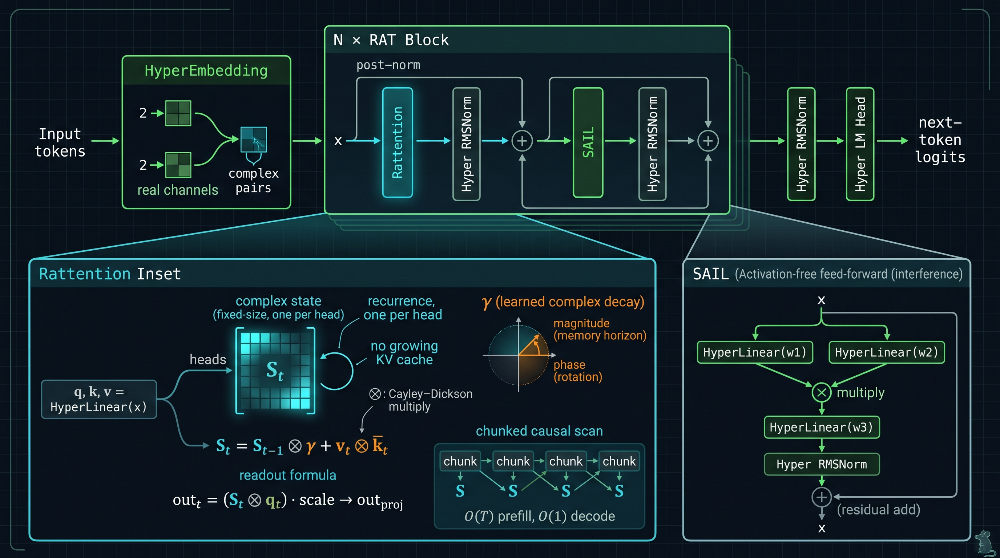
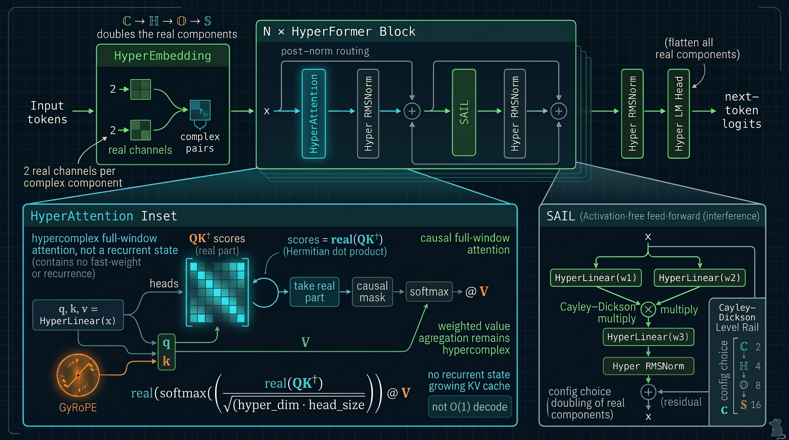
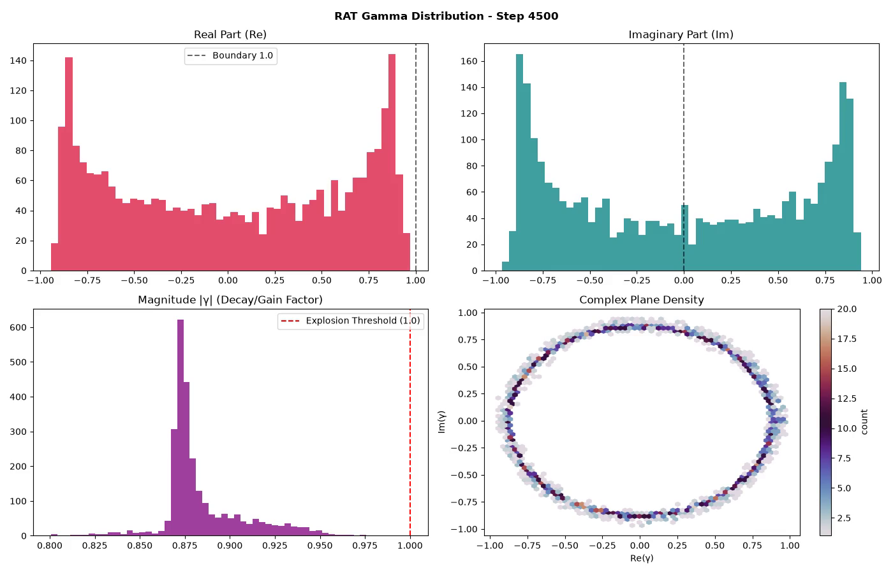
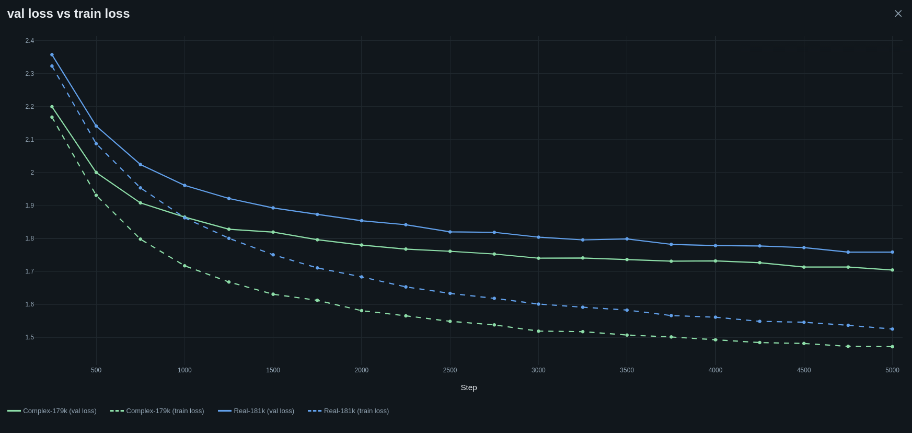
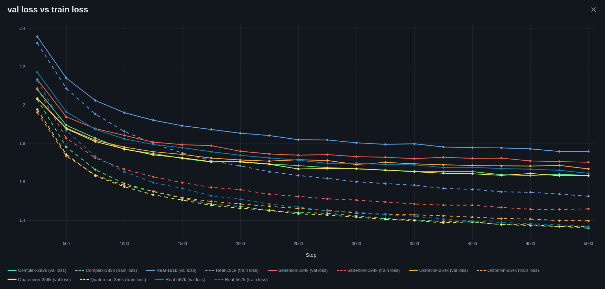
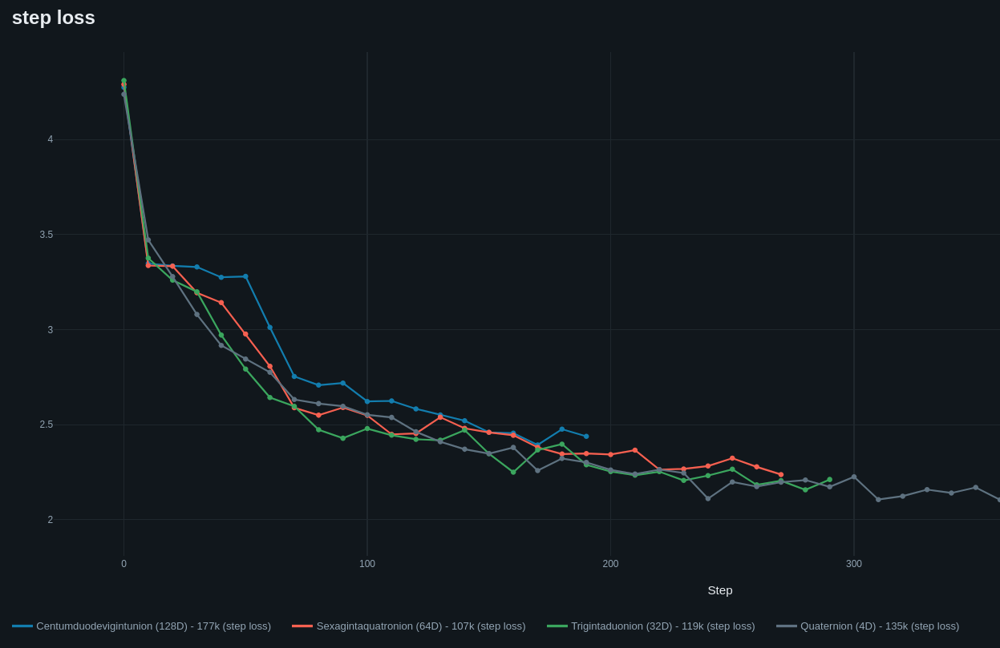

<div align="center">
  
# Text And Rotating Dimensions In Token Space<br><sup><small>*oder: wie man LMs innen größer macht*</small></sup>

🇬🇧 [English](README.md) | 🇩🇪 **Deutsch** | 🇨🇿 [Čeština](README.cs.md) | 🇨🇳 [中文](README.zh.md) | 🇷🇺 [Русский](README.ru.md)

<a href="https://git.pvlb.dev/ml-lab/tardits"> Haupt-Repo - https://git.pvlb.dev/ml-lab/tardits</a><br>
<small><GitHub mirror: <a href="https://github.com/pvlb-dev/tardits" target="_blank">https://github.com/pvlb-dev/tardits</a>></small>

> Dies ist die deutsche Übersetzung für v0.3.0. Das englische README ist die maßgebliche Fassung: [README.md](README.md).

---

</div>
<br>


### Willkommen bei **TARDITS**, einem kleinen Labor für komplexwertige Sprachmodelle!

**v0.3.0 bringt RAT** - einen *Recurrent Attention Transformer*: Softmax-Attention
wird durch einen linearen Fast-Weight-Speicher mit gelerntem komplexem Decay ersetzt.
Der Zustand hat feste Größe, die Generierung ist O(1) pro Token, und der KV-Cache
wächst nicht. Es ist ein anderer Trade-off, kein kostenloser Gewinn: bei abgestimmter
LR **liegt RAT33 mit 31 % weniger Parametern gleichauf mit dem 48M-RealGPT bei der
mittleren Validierungs-Loss auf FineWeb**, und RAT ist bei langem Decode deutlich
schneller. Beide haben weiterhin klare Grenzen bei Retrieval und Interpretierbarkeit.
Die ehrlichen Ergebnisse, inklusive der Nullresultate, sind unten verlinkt.

<p align="center">

</p>

> Die Evidenztabelle und die ehrlichen Einschränkungen zu v0.3.0 stehen in
> [docs/index.md](docs/index.md). Die FineWeb-Läufe, der Data-Order-Rerun und der
> Vergleich RAT vs. Real lösen die alte reine Shakespeare-Erzählung ab.
> Weitere RAT/HyperFormer-Dokumentation und größere Läufe sind in Arbeit; dieses
> Release ist der Ausgangspunkt, nicht das letzte Wort.


<details>
<summary><b>Wie es begann</b> - die v0.0.0-Geschichte 🔻</summary>

<br>

TARDITS begann als meine Umsetzung des großartigen
[Let's build GPT](https://youtu.be/kCc8FmEb1nY?si=I0z2-jByJj_6_QIH)-Tutorials. Nachdem
ich mein GPT-Net fertiggestellt und aktualisiert hatte (RoPE, SwiGLU, RMSNorm ...), kam
mir die Idee, einen komplexen Transformer zu schreiben. Vor allem, weil ich mich gefragt
habe, ob sie *wirklich* eine Aktivierungsfunktion brauchen ... es stellt sich heraus:
**brauchen sie nicht 🤯**

Nach ein paar Iterationen wurde das $\mathbb{C}$-Netz überraschend stabil. Natürlich
musste ich als Nächstes Quaternionen ($\mathbb{H}$) ausprobieren. Sie wurden mit der
Cayley-Dickson-Konstruktion gebaut - also schicke ich 2 komplexe Werte durch den
Transformer und lasse PyTorch die ganze Backprop-Arbeit machen. Dann eskalierte das
Konzept ein wenig, und irgendwie entstanden auch die Oktionen- ($\mathbb{O}$) und
Sedenion-Netze ($\mathbb{S}$). Beide funktionieren, aber sie brauchen sehr lange zum
Trainieren. Besonders auf der CPU :D

Es mag bessere Verwendungszwecke für CVNNs geben als Textvorhersage ... aber warum
nicht Shakespeare?

</details>

---

<br>


## 🙃 Architektur
<details>
<summary><b>Zum Ausklappen 🔻</b></summary>

### 🐀 v0.3.0 - RAT (aktuell)

<p align="center">

</p>

*RAT-Block. `Rattention` hält einen komplexen Fast-Weight-Zustand fester Größe mit
gelerntem Decay `γ`; `SAIL` ist der aktivierungsfreie Feed-Forward-Pfad.*

RAT ersetzt den Softmax/KV-Pfad durch einen linearen Fast-Weight-Speicher:

```
S_t = S_{t-1} ⊗ gamma + v_t ⊗ conjugate(k_t)
out_t = (S_t ⊗ q_t) * scale -> out_proj
```

`gamma` wird pro Zustandselement gelernt; seine Magnitude ist der Speicherhorizont und
seine Phase rotiert Assoziationen. Das ist der `LinA`-Prototyp, integriert in `tardits`.

**Was daran besonders ist**

- **Zustand fester Größe:** Decode ist O(1) pro Token und es gibt keinen wachsenden
  KV-Cache; Prefill ist O(T) mit einem gechunkten kausalen Scan.
- **Gedächtnis und Position in einem Parameter:** Der komplexe Decay trägt sowohl den
  Vergessenshorizont als auch die relative Phase; keine separate absolute
  Positionstabelle.
- **Aktivierungsfrei:** Derselbe SAIL-Block und Hypercomplex-Embedding-Stack
  funktionieren ohne MLP-Aktivierung.
- **Ehrliche Grenzen:** Bei 11M-45M Parametern ist RAT auf FineWeb konkurrenzfähig und
  bei langem Decode deutlich schneller. NIAH/Retrieval ist bei den aktuellen Skalen ein
  sauberes Nullresultat für **sowohl RAT als auch RealGPT**; Skalierung und bessere
  NIAH-Tests laufen. Die Trigger/Gating-Probes sind Forschungsnotizen, keine
  Fähigkeiten.

### 🧬 v0.2.0 - HyperFormer

<p align="center">

</p>

*HyperFormer-Block. GyRoPE rotiert q/k, die Scores nutzen den Realteil des Hermiteschen
Produkts, und die Attention-Gewichte bleiben reell, während die Werte hyperkomplex
bleiben.*

HyperFormer ist der Vorgänger und der allgemeine hyperkomplexe Pfad: derselbe Block wird
auf den Cayley-Dickson-Stufen ℂ, ℍ, 𝕆 und 𝕊 instanziiert. Er behält kausale Attention
über das volle Fenster (kein KV-Cache in der aktuellen Implementierung, kein
O(1)-Decode-Versprechen), nutzt GyRoPE für die Position und nimmt den Realteil von
`QK†` als Softmax-Score.

### 🧩 Module

#### ⛵ SAIL (Self-Activating Interference Layer)
In Standard-$\mathbb{R}$-Netzen sind nichtlineare Aktivierungsfunktionen in der
Feed-Forward-Schicht zwingend erforderlich. Eine komplexe lineare Schicht ist weiterhin
linear; die Nichtlinearität in **SAIL** entsteht durch die Multiplikation von **zwei
Projektionen derselben Eingabe**: `SAIL(z) = (W₁z) ⊗ (W₂z)`, was quadratisch ist. Es ist
im Wesentlichen SwiGLU ohne das „Swi“: Aufteilen über zwei lineare Schichten,
hyperkomplex multiplizieren, dann projizieren. Zusammen mit Residualverbindungen
`z = z + SAIL(z)` reicht das für einen trainierbaren komplexen Transformer.

#### 🪢 GyRoPE - lernbares RoPE, voller Kreis
Beim ~~Implementieren~~ Experimentieren mit RoPE in meinem $\mathbb{R}$-Netz habe ich
festgestellt, dass ein trainierbares RoPE, das zufällig von $ -2\pi$ bis $2\pi$
initialisiert wird, mit klassischen Positionskodierungen mithielt. Es funktioniert gut
mit den komplexen Transformern, obwohl es nur wenige Gewichte gibt und sich diese
langsam ändern.

* $\mathbb{C}$-RoPE rotiert in der komplexen $2\mathcal{D}$-Ebene.
* $\mathbb{H}$-RoPE rotiert um eine Einheits-3-Sphäre ($S^3$).
* $\mathbb{O}$ und $\mathbb{S}$ rotieren um ihre jeweiligen hypersphärischen Gegenstücke.

#### 👀 HyperAttention
Wie leitet man Attention in komplexen Räumen? **Einfachheit gewinnt.** Die Scores nutzen
das Hermitesche Skalarprodukt ($Q K^\dagger$); man nimmt nur den **Realteil**, wendet
die kausale Maske und Standard-Softmax an:

```python
# In C-Space:
wei = (q @ k.adjoint()) * (2 * self.head_size) ** -0.5
wei = wei.real
wei = F.softmax(wei.masked_fill(self.tril[:T, :T] == 0, float("-inf")), dim=-1)
# Weighted value aggregation remains hypercomplex:
out = wei.to(v.dtype) @ v
```

Der Realteil erfasst Phasenausrichtung und Magnitude und wirkt als skalarer
Affinitäts-Score; die reellen Gewichte skalieren dann die vollen hyperkomplexen
Wertvektoren.

#### 🐀 Rattention
`Rattention` ist das lineare Fast-Weight-Modul: q/k/v-Projektionen, ein komplexer
Zustand pro Head, `S_t = S_{t-1} ⊗ γ + v_t ⊗ k̄_t` und das Readout
`(S_t ⊗ q_t)·scale`. `forward` (Training) und das rekurrente `step` (Generierung) werden
durch Tests gegenseitig geprüft.

#### 🏋️ Gewichtsinitialisierung
Attention- und SAIL-Gewichte werden um den Einheitskreis/die Einheitssphäre
initialisiert und skaliert mit:

$$\sqrt{\frac{S}{d_{in} + d_{out}}}$$

wobei $S$ für $\mathbb{C}=1.0$, $\mathbb{H}=0.5$, $\mathbb{O}=0.25$, $\mathbb{S}=0.125$
steht.

#### 🛌 Embedding & LM-Head
Tokens werden auf einen komplexen hyperkomplexen Tensor abgebildet, mit einem
Real-/Imaginärteil-Paar pro komplexer Komponente; der LM-Head flacht alle
Real-/Imaginärteile wieder zu $\mathbb{R}$-Logits ab.

#### 🛡️ RMSNorm - Amplituden normieren, Phasen erhalten
🧨 entfernen bei explodierendem Transformer-Rauschen (NaN) 💥

Standard-Normalisierung kann geometrische Phaseninformationen in komplexen Räumen
verzerren. Das eigene **RMSNorm** berechnet den RMS aus den Vektormagnituden
($\Vert q\Vert^2 = |z_1|^2 + |z_2|^2$) und skaliert die Amplituden neu, während die
Phasen intakt bleiben.

<br>
<br>

</details>

## 🔥 Heiße Kurven (Benchmarks & Ergebnisse)
<details>
<summary><b>Zum Ausklappen 🔻</b></summary>

<br>

### 🌊 SAIL-Interferenzmuster ($\mathbb{C}$)

#### 🎬 2D-SAIL-Interferenz-Evolution
[](https://www.youtube.com/watch?v=nFiWQWMtX-Q)
[](https://youtube.com/shorts/OIvpBzp8Y8c?si=LPVmYf6Skw9IRELd)

#### 🎬 3D-SAIL-Phasen-Amplituden-Topografie
[](https://youtu.be/r6ykSiY3ipY?si=VosKe4IpfWTy1jbz)
[](https://youtube.com/shorts/7kjrDF7-UUg?si=jcLONq29jUDC2mVX)

*Abbildung: Entwicklung der selektiven Phaseninterferenz über alle 8 Transformer-Schichten im Verlauf der Trainingsschritte. Tiefe Schichten (6 & 7) zeigen extreme destruktive Phasenauslöschung neben messerscharfen Resonanzspitzen (> 10,000 Amplitude). Deshalb ergibt das Post-Norm-Design hier viel Sinn*

<br>

### 🧪 FineWeb - RAT vs RealGPT

Char-level FineWeb, 90.1M Zeichen pro Arm, Block 1024, Batch 4. Die Zeilen sind 22k
Iterationen, sofern nicht anders vermerkt; alle nutzen den Data-Order-Fix. Die
RAT-L1-Zeilen wurden mit dem stabilen #23-Scan trainiert.

| Modell | LR | Schritte | Parameter | Zeichen/Parameter | Val Loss | Anmerkung |
|---|---:|---:|---:|---:|---:|---|
| **RAT L1 33.4M** | 3e-4 | 34k | 33.37M | 4.2 | **1.2357 / 1.2364** | Mittel **1.2361**, zwei Seeds |
| **RealGPT 48.1M** | 1e-4 | 36k | 48.09M | 3.1 | **1.2485 / 1.2225** | Mittel **1.2355**, zwei Seeds |
| RAT L1 33.4M (22k) | 3e-4 | 22k | 33.37M | 2.7 | 1.2540 / 1.2902 | älterer kurzer Lauf |
| RAT L1 44.8M | 3e-4 | 22k | 44.76M | 2.0 | 1.2911 | 1.6× Wall-Clock vs. Real |
| RAT L1 11.2M | 3e-4 | 22k | 11.24M | 8.0 | 1.2845 | Rerun mit Data-Order-Fix |
| RealGPT 11.1M | 3e-4 | 22k | 11.13M | 8.1 | 1.3253 | Rerun mit Data-Order-Fix |
| HyperFormer 11.2M | 3e-4 | 22k | 11.2M | 8.0 | 1.2950 | 8-Head-Control |
| RAT 6.47M | 3e-4 | 22k | 6.47M | 13.9 | 1.3669 | Degradationspunkt |
| RealGPT 48.1M (alt) | 3e-4 | 22k | 48.09M | 1.9 | 1.5523 | dasselbe Modell, falsche LR |

**Bei abgestimmter LR und vergleichbarem Budget liegen RAT33 und Real48 bei der
mittleren Val gleichauf**: 1.2361 vs. 1.2355, ein Unterschied von 0.0006. RAT33
erreicht das mit **31 % weniger Parametern**, aber seine beiden Seeds sind nahezu
identisch (Spanne 0.0007), während die Spanne von Real bei ~0.026 liegt. Die ehrliche
Aussage ist **Parität / Parametereffizienz**, nicht „RAT gewinnt“ oder „Real gewinnt“.

Die LR-Suchen waren am Ende symmetrisch: Real48 1e-4 schlug 3e-4/5e-4; RAT33 3e-4
schlug 1e-4. Frühere Real-vs-RAT-Schlagzeilen mit 3e-4 auf beiden Seiten waren
LR-verfälscht. RAT44 ist jedoch breitenabhängig, keine Wrong-LR-Kontrolle:
1e-4 half ihm (3e-4 1.2911 -> 1e-4 1.2675 bei 26.5k), während 1e-4 RAT33
(1.2874) und RAT22 (1.3199) schadete.

Einschränkung: Die Token-Budgets sind nah: RAT 34k x 1024 x 4 = 139.3M Zeichen,
Real 147.5M. Retrieval jenseits des Fensters ist bei diesen Skalen ein sauberes
Nullresultat für **beide** Modelle ([NIAH](docs/findings/niah-fineweb.md)); Skalierung
und bessere NIAH-Tests laufen, daher bleiben Long-Context-Aussagen vorerst reine
Geschwindigkeitsaussagen.

#### 📈 Width-Skalierung

<p align="center">

</p>

*Breiten-Sweep bei 9 Schichten. 11.2M ist der überraschende Punkt - innerhalb des
33M-Seed-Bereichs und in diesem Lauf gleichauf mit 44M; 6.47M degradiert. Der
11M-Punkt in der Tabelle oben ist der spätere Rerun mit Data-Order-Fix, die Kurven sind
also richtungsweisend und keine weitere Seed-Replik.*

### 🧠 Was RAT gut kann (Forschungsvorschau)

Ein winziges RAT mit 143k Parametern, trainiert auf einem einzigen zufälligen
512-Zeichen-Text, reproduziert den **gesamten restlichen String** aus einem 16- oder
32-Zeichen-Prompt (Teacher-Forcing-Genauigkeit 0.996-0.998), während das passende
RealGPT direkt hinter seinem trainierten Block scheitert. Das ist ein
Relative-Position-/Recurrent-State-Effekt, keine allgemeine Long-Context-Fähigkeit: die
Adjacent-Copy-Kontrolle von NIAH schlägt weiterhin fehl, und eine namespace-saubere
Trigger-Probe zeigt, dass RAT eine Payload memorieren, aber nicht zuverlässig auf den
Trigger gaten kann. Die ganze Geschichte, inklusive der fehlgeschlagenen Kontrollen,
steht in
[`docs/experiments/2026-11-04-memorize.md`](docs/experiments/2026-11-04-memorize.md)
und [`docs/experiments/2026-11-05-trigger.md`](docs/experiments/2026-11-05-trigger.md).
Größere Läufe und mehr RAT-Dokumentation sind in Arbeit.

### ⚡ Decode-Geschwindigkeit

<p align="center">

</p>

*Nur Decode, KV-gecachtes RealGPT als Baseline. Dies ist der ältere Benchmark im kleinen
Maßstab (0.9M) auf Shakespeare: RAT L1 ist annähernd flach (~317-363 tok/s), während
RealGPT über 16→2048 von ~392 auf ~215 tok/s fällt. Die T4/CPU-Zahlen für die großen
Modelle stehen unten.*

#### Durchsatz & Speicher der großen Modelle (B=8, 2048 Tokens)

<p align="center">

</p>

| Modell | Decode tok/s | Peak GB | vs. Real-Speicher |
|---|---:|---:|---:|
| **RAT22** | **782** | **0.48** | **~7.1× weniger** |
| RAT33 | 624 | 0.62 | ~5.5× weniger |
| RAT44 | 621 | 0.66 | ~5.2× weniger |
| Real48 | 487 | 3.43 | 1× |

Das ist der Trade-off in einer Tabelle: Bei Single-Stream/kurzem Kontext ist Real48
schneller (96 vs. 77 tok/s) und RAT44 langsamer, aber bei Batch 8 / 2048 sind RAT33/44
~1.25× schneller **und brauchen ein Fünftel des Speichers**. RAT22 ist der
Durchsatz-Sieger bei einem Siebtel des Speichers, mit schwächerer Qualität. Siehe
[den vollständigen Geschwindigkeitsbericht](docs/experiments/2026-11-08-inference-speed-big.md).

### 🎚️ Gelerntes Decay

<p align="center">

</p>

*Pro Schicht gelerntes `|γ|` im finalen L1-Shakespeare-Checkpoint: Das Modell wählt
kurze Horizonte (~8-13 Tokens) statt eines globalen Decay. Ein kleines Modell auf
winzigen Daten, aber es zeigt, dass der Parameter echte Arbeit leistet; das
Long-Context-/State-Audit steht in [RAT-Decay](docs/findings/rat-decay.md) und
[State-Probe](docs/findings/rat-state-probe.md).*

<p align="center">

</p>

*Posterframe aus dem Video zur Entwicklung des gelernten Decay; das MP4 ist in
[der Doku](docs/index.md) verlinkt.*

### 📉 Shakespeare-Läufe (älter)

gemeinsame Parameter:

| batch_size | block_size | dropout | learning rate | vocab_size |
| :--------- | :--------: | :-----: | :-----------: | ---------- |
| 32         |    128     |   0.2   |    0.0005     | 65         |

#### $\mathbb{C}$ vs $\mathbb{R}$ / beide ~180k Parameter


| Modell         |    Raum     | $n_{embd}$ | Schichten | Heads | Parameter | Train Loss | Val Loss  |
| :------------- | :----------: | :--------: | :----: | :---: | :----: | :--------: | :-------: |
| **ComplexGPT** | $\mathbb{C}$ |     54     |   4    |   6   | ~179k  | **1.472**  | **1.704** |
| **RealGPT**    | $\mathbb{R}$ |     60     |   4    |   6   | ~181k  |   1.526    |   1.759   |

#### $\mathbb{R}$ vs. der komplexe Rest

Anzahl der Parameter skaliert. Hinweis: Die höherdimensionalen Läufe dauern *ewig*. Ein
„Sedenion“ braucht 256 Multiplikationen statt einer.


*Abbildung: Verläufe von Trainings- und Validierungsverlust über die Räume ($\mathbb{R}, \mathbb{C}, \mathbb{H}, \mathbb{O}, \mathbb{S}$). Beachte, wie Complex-383k (grün) durchgängig die größere Real-Baseline (blau) übertrifft.*

| Modell            |    Raum     | $n_{embd}$ | Schichten | Heads | Parameter | Train Loss | Val Loss  |
| :---------------- | :----------: | :--------: | :----: | :---: | :----: | :--------: | :-------: |
| **RealGPT**       | $\mathbb{R}$ |     96     |   5    |   6   | ~567k  |   1.367    |   1.645   |
| **ComplexGPT**    | $\mathbb{C}$ |     72     |   5    |   6   | ~384k  | **1.359**  |   1.633   |
| **QuaternionGPT** | $\mathbb{H}$ |     54     |   4    |   4   | ~356k  |   1.367    | **1.633** |
| **OctonionGPT**   | $\mathbb{O}$ |     32     |   4    |   4   | ~264k  |   1.398    |   1.668   |
| **SedenionGPT**   | $\mathbb{S}$ |     18     |   4    |   6   | ~184k  |   1.460    |   1.702   |

<br>

<details>
<summary><b>v0.2.0-Bonus - Centumduodevigintunions 🔻</b></summary>

Es ist lächerlich, sinnlos und ich kann es nicht einmal buchstabieren ... aber es läuft
(sehr langsam). Die interessantesten Anwendungsfälle finden sich wohl auf Stufe 1-3 ;)
</details>

<br><br>


</details>


## 🚀 Schnellstart & Nutzung


### Installation

```bash
pip install tardits
# or
uv add tardits
```

Optional - für Experiment-Tracking mit [MLFlow](https://github.com/mlflow/mlflow):

```bash
pip install tardits[mlflow]
```

### Schnellstart

#### Beispielkonfiguration (als .yaml speichern):
```yaml
device: "auto" # Choices: "auto", "cuda", "cpu", "mps"
seed: 1337

model:
  arch: hyper # optional: real | hyper | rat (default: level < 1 -> real, else hyper)
  level: 1 # Complex
  block_size: 64
  n_head: 6
  n_embd: 42
  n_layer: 4
  dropout: 0.2

trainer:
  batch_size: 32
  max_iters: 5000
  eval_interval: 500
  learning_rate: 0.0005
  eval_iters: 200
  save_interval: 0
  checkpoint: "saved_model.pt"

mlflow:
  experiment: "" # add name to enable
  log_interval: 10
  deep_log_interval: 0
  system_metrics: false

data:
  input_path: "my_training_data.txt"
  vocab_save_path: "saved/charset.txt"
```
Du kannst auch eine Konfiguration aus [examples/configs] und die shakespeare.txt aus
[examples/data] nehmen.

#### RAT-Variante

Tausche den Model-Block aus; der Trainer und `tgen` bleiben unverändert:

```yaml
model:
  arch: rat
  level: 1             # complex
  block_size: 128
  n_head: 21
  n_embd: 84
  n_layer: 8
  dropout: 0.2
```

Die Referenz-FineWeb-Konfigurationen liegen in
`experiments/configs/fineweb/` (RAT 11M/33M/45M).

#### Training starten
```bash
ttrain -c config.yaml
```

#### Text generieren
```bash
tgen -c config.yaml -p "To be or not to be" -l 200

tgen -h
options:
  -h, --help            show this help message and exit
  --config, -c CONFIG   Path to YAML configuration file
  --arch, -a ARCH       Override the model family selected in the config
                        (hyper | rat | real)
  --checkpoint CHECKPOINT
                        Optional override for model checkpoint path
  --vocab VOCAB         Optional override for vocab path
  --prompt, -p PROMPT   Text prompt to start generation
  --length, -l LENGTH   Number of tokens to generate
  --temp, -t TEMP       Model sampling temperature
  --top_k, -k TOP_K     Top-k sampling threshold
  --follow, -f          Endless stream of tokens
  --delay DELAY         Delay between tokens in follow mode (seconds)
```


### v0.3.0 (aktuelles Release) - RAT
- [x] **RAT (`arch: rat`):** linearer Fast-Weight-Speicher, gelernter komplexer Decay, O(1)-Decode, gechunkter kausaler Prefill.
- [x] **RAT-Port + Tests:** `forward`/`step`-Äquivalenz, Prefill/Generate, Regression für den gelernten Gamma-Scan, alle Archs.
- [x] **FineWeb-Evidenz:** 11M/33M/45M RAT vs. 11M/48M RealGPT, inklusive des Data-Order-Reruns und der symmetrischen LR-Behandlung: RAT33 3e-4/34k Mittel 1.2361 vs. Real48 1e-4/36k Mittel 1.2355, mit 31 % weniger RAT-Parametern. Historische RAT-L1-Zeilen sind pre-#23; das RAT33-Langlaufpaar ist #23-sauber.
- [x] **Aktuelle Nullresultate:** Die NIAH-Adjacent-Copy-Kontrolle schlägt für RAT und RealGPT fehl; Skalierung und bessere NIAH-Tests laufen, daher noch keine Long-Context-Retrieval-Behauptung.
- [x] **CLI + Configs:** `ttrain` / `tgen` für real, hyper, rat; MLflow-Tracking.
- [ ] **PyPI 0.3.0:** Der Port ins Release-Repo ist in #1 erfasst.

<br>


## 🧭 Ausblick
- **Text-Diffusion:** die Wette für 0.4.0 - ein Text-Diffusionsmodell mit RAT- und hyperkomplexen Varianten, kein weiteres rein autoregressives Release.
- **Hijack-Distillation:** eingefrorenes Teacher-Embedding/Head + RAT-Kern; Logit-KL- und Hidden-MSE-Probes (Forschung; kein 0.3.0-Feature).
- **Paper:** RAT-Methode + FineWeb-Evidenz + Nullresultate (`paper/`, nach dem Release).
