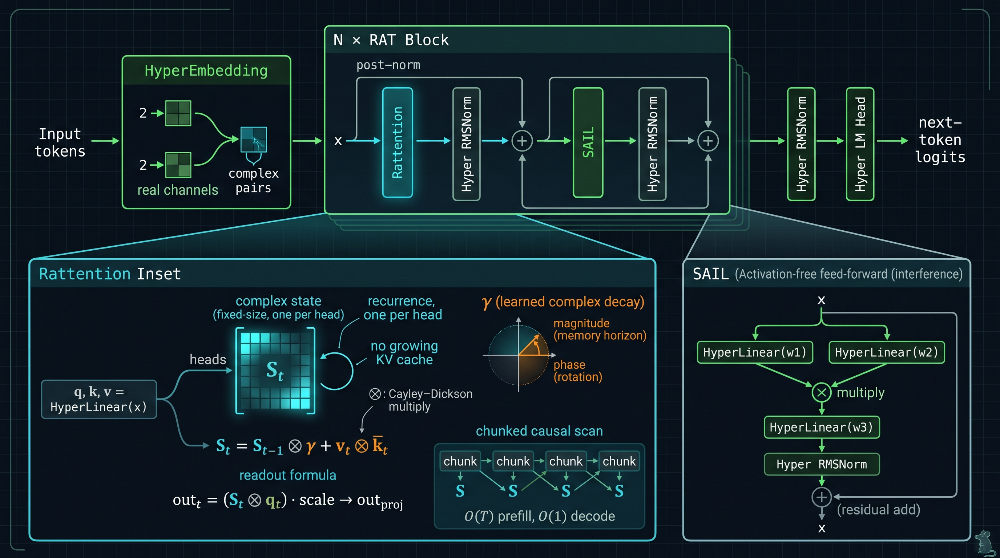
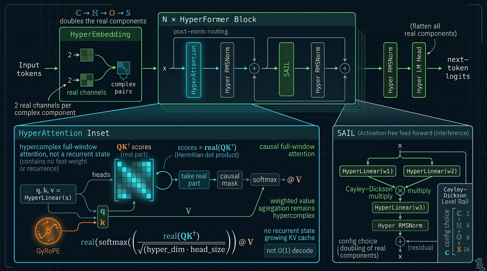
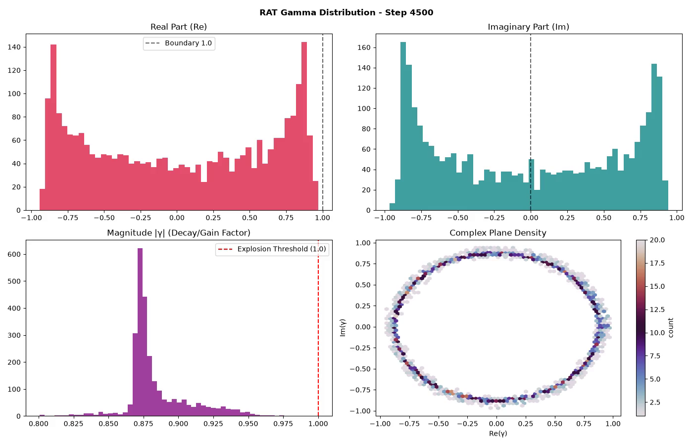
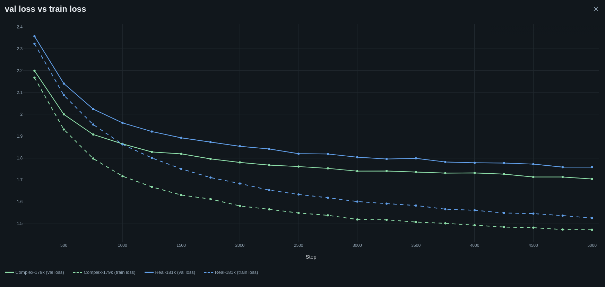
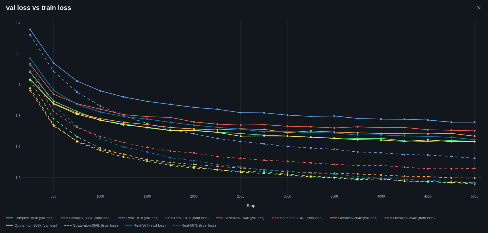
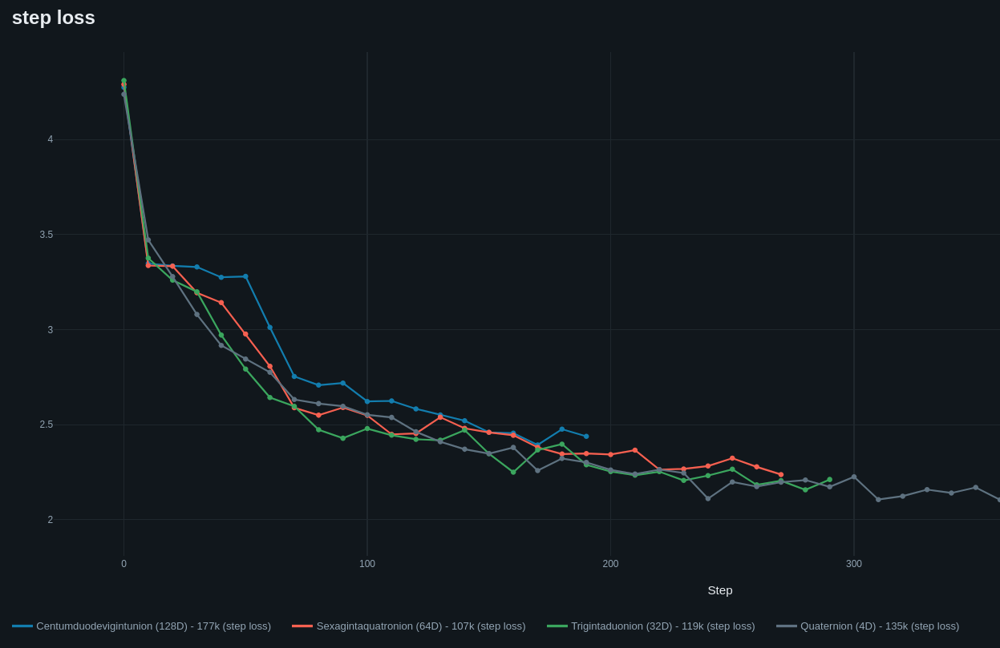

<div align="center">
  
# Text And Rotating Dimensions In Token Space<br><sup><small>*or: how to make LMs bigger on the inside*</small></sup>

🇬🇧 **English** | 🇩🇪 [Deutsch](README.de.md) | 🇨🇿 [Čeština](README.cs.md) | 🇨🇳 [中文](README.zh.md) | 🇷🇺 [Русский](README.ru.md)

<a href="https://git.pvlb.dev/ml-lab/tardits"> Home repo - https://git.pvlb.dev/ml-lab/tardits</a><br>
<small><GitHub mirror: <a href="https://github.com/pvlb-dev/tardits" target="_blank">https://github.com/pvlb-dev/tardits</a>></small>

---

</div>
<br>


### Welcome to **TARDITS**, a small lab for Complex-Valued language models!

**v0.3.0 adds RAT** - a *Recurrent Attention Transformer*: softmax attention is
replaced by a linear fast-weight memory with a learned complex decay. The state is
fixed-size, generation is O(1) per token, and there is no KV-cache growth. It is a
different trade-off, not a free win: at tuned LR, **RAT33 ties the 48M RealGPT on
FineWeb mean validation loss with 31% fewer parameters**, and RAT is much faster at
long-context decode. Both still have clear retrieval and interpretability limits.
The honest results, including the nulls, are linked below.

<p align="center">

</p>

> The v0.3.0 evidence table and honest limitations are in
> [docs/index.md](docs/index.md). The FineWeb runs, data-order rerun and the
> RAT-vs-Real comparison supersede the old Shakespeare-only story.
> More RAT/HyperFormer documentation and bigger runs are on the way; this release is
> the starting point, not the final word.


<details>
<summary><b>How it started</b> - the v0.0.0 story 🔻</summary>

<br>

TARDITS started as my take on the awesome
[Let's build GPT](https://youtu.be/kCc8FmEb1nY?si=I0z2-jByJj_6_QIH) tutorial. After
finishing my GPT-net and updating it (RoPE, SwiGLU, RMSNorm...), I got the idea to write
a complex transformer. Mainly because I asked myself if they *really* need an activation
function... turns out **they don't 🤯**

After a few iterations, the $\mathbb{C}$ -net got surprisingly stable. Of course, I had
to try quaternions ($\mathbb{H}$) next. They were built using the Cayley–Dickson
construction - so I pass 2 complex values through the transformer and let PyTorch do all
the backprop work. Then the concept escalated a little, and the Octonion ($\mathbb{O}$)
and Sedenion ($\mathbb{S}$) nets also somehow happened. Both work, but they take a
really long time to train. Especially on CPU :D

There may be better uses for CVNNs than predicting text... but why not Shakespeare?

</details>

---

<br>


## 🙃 Architecture
<details>
<summary><b>Click to expand 🔻</b></summary>

### 🐀 v0.3.0 - RAT (current)

<p align="center">

</p>

*RAT block. `Rattention` keeps a fixed-size complex fast-weight state with a
learned decay `γ`; `SAIL` is the activation-free feed-forward path.*

RAT replaces the softmax/KV path with a linear fast-weight memory:

```
S_t = S_{t-1} ⊗ gamma + v_t ⊗ conjugate(k_t)
out_t = (S_t ⊗ q_t) * scale -> out_proj
```

`gamma` is learned per state element; its magnitude is the memory horizon and its
phase rotates associations. This is the `LinA` prototype integrated into `tardits`.

**What is special about it**

- **Fixed-size state:** decode is O(1) per token and there is no growing KV cache;
  prefill is O(T) with a chunked causal scan.
- **Memory and position in one parameter:** the complex decay carries both the
  forgetting horizon and the relative phase; no separate absolute position table.
- **Activation-free:** the same SAIL block and hypercomplex embedding stack work
  without an MLP activation.
- **Honest limits:** at 11M–45M params RAT is competitive on FineWeb and much faster
  at long decode. NIAH/retrieval is a clean null for **both RAT and RealGPT** at the
  current scales; scaling and better NIAH tests are in progress. The trigger/gating
  probes are research notes, not capabilities.

### 🧬 v0.2.0 - HyperFormer

<p align="center">

</p>

*HyperFormer block. GyRoPE rotates q/k, scores use the real part of the Hermitian
product, and attention weights stay real while values stay hypercomplex.*

HyperFormer is the predecessor and the general hypercomplex path: the same block is
instantiated at Cayley–Dickson levels ℂ, ℍ, 𝕆 and 𝕊. It keeps causal full-window
attention (no KV cache in the current implementation, no O(1) decode claim), uses
GyRoPE for position, and takes the real part of `QK†` as the softmax score.

### 🧩 Modules

#### ⛵ SAIL (Self-Activating Interference Layer)
In standard $\mathbb{R}$ -nets, nonlinear activation functions in the feed-forward
layer are strictly necessary. A complex linear layer is still linear; the nonlinearity
in **SAIL** comes from multiplying **two projections of the same input**:
`SAIL(z) = (W₁z) ⊗ (W₂z)`, which is quadratic. It is essentially SwiGLU without the
"Swi": split via two linears, multiply hypercomplexly, then project. Combined with
residual connections `z = z + SAIL(z)`, that is enough for a trainable complex
transformer.

#### 🪢 GyRoPE - learnable RoPE, full circle
While ~~implementing~~ experimenting with RoPE in my $\mathbb{R}$ -net, I found that a
trainable RoPE initialized randomly from $ -2\pi$ to $2\pi$ matched classical
positional encodings. It works nicely with the complex transformers, though the
weights are few and change slowly.

* $\mathbb{C}$ -RoPE rotates in the $2\mathcal{D}$ complex plane.
* $\mathbb{H}$ -RoPE rotates around a unit 3-sphere ($S^3$).
* $\mathbb{O}$ and $\mathbb{S}$ rotate around their respective hyperspherical counterparts.

#### 👀 HyperAttention
How do you route attention in complex spaces? **Simplicity wins.** Scores use the
Hermitian dot product ($Q K^\dagger$); take only the **real component**, apply the
causal mask and standard softmax:

```python
# In C-Space:
wei = (q @ k.adjoint()) * (2 * self.head_size) ** -0.5
wei = wei.real
wei = F.softmax(wei.masked_fill(self.tril[:T, :T] == 0, float("-inf")), dim=-1)
# Weighted value aggregation remains hypercomplex:
out = wei.to(v.dtype) @ v
```

The real part captures phase alignment and magnitude, acting as a scalar affinity
score; the real weights then scale the full hypercomplex value vectors.

#### 🐀 Rattention
`Rattention` is the linear fast-weight module: q/k/v projections, a per-head complex
state, `S_t = S_{t-1} ⊗ γ + v_t ⊗ k̄_t`, and the readout `(S_t ⊗ q_t)·scale`.
`forward` (training) and recurrent `step` (generation) are cross-checked by tests.

#### 🏋️ Weight Initialization
Attention and SAIL weights are initialized around the unit circle/sphere and scaled by:

$$\sqrt{\frac{S}{d_{in} + d_{out}}}$$

where $S$ is $\mathbb{C}=1.0$, $\mathbb{H}=0.5$, $\mathbb{O}=0.25$, $\mathbb{S}=0.125$.

#### 🛌 Embedding & LM-Head
Tokens map into a complex hypercomplex tensor with one real/imaginary pair per
complex component; the LM head flattens all real/imaginary components back to
$\mathbb{R}$ logits.

#### 🛡️ RMSNorm - norming amplitudes, preserving phases
🧨 remove for exploding transformer noises (NaN) 💥

Standard normalization can distort geometric phase information in complex spaces.
The custom **RMSNorm** computes the RMS from vector magnitudes
($\Vert q\Vert^2 = |z_1|^2 + |z_2|^2$) and rescales amplitudes while leaving phases intact.

<br>
<br>

</details>

## 🔥 Hot Curves (Benchmarks & Results)
<details>
<summary><b>Click to expand 🔻</b></summary>

<br>

### 🌊 SAIL Interference Patterns ($\mathbb{C}$)

#### 🎬 2D SAIL Interference Evolution
[](https://www.youtube.com/watch?v=nFiWQWMtX-Q)
[](https://youtube.com/shorts/OIvpBzp8Y8c?si=LPVmYf6Skw9IRELd)

#### 🎬 3D SAIL Phase-Amplitude Topography
[](https://youtu.be/r6ykSiY3ipY?si=VosKe4IpfWTy1jbz)
[](https://youtube.com/shorts/7kjrDF7-UUg?si=jcLONq29jUDC2mVX)

*Figure: Evolution of selective phase interference across all 8 Transformer layers over training steps. Deep layers (6 & 7) demonstrate extreme destructive phase cancellation alongside razor-sharp resonance peaks (> 10,000 amplitude). That's why the Post-Norm design makes a lot of sense here*

<br>

### 🧪 FineWeb - RAT vs RealGPT

Char-level FineWeb, 90.1M chars per arm, block 1024, batch 4. Rows are 22k
iterations unless noted; all use the data-order fix. The RAT L1 rows were trained
with the stable #23 scan.

| model | lr | steps | params | chars/param | val loss | note |
|---|---:|---:|---:|---:|---:|---|
| **RAT L1 33.4M** | 3e-4 | 34k | 33.37M | 4.2 | **1.2357 / 1.2364** | mean **1.2361**, two seeds |
| **RealGPT 48.1M** | 1e-4 | 36k | 48.09M | 3.1 | **1.2485 / 1.2225** | mean **1.2355**, two seeds |
| RAT L1 33.4M (22k) | 3e-4 | 22k | 33.37M | 2.7 | 1.2540 / 1.2902 | older short run |
| RAT L1 44.8M | 3e-4 | 22k | 44.76M | 2.0 | 1.2911 | 1.6× wall-clock vs Real |
| RAT L1 11.2M | 3e-4 | 22k | 11.24M | 8.0 | 1.2845 | data-order-fixed rerun |
| RealGPT 11.1M | 3e-4 | 22k | 11.13M | 8.1 | 1.3253 | data-order-fixed rerun |
| HyperFormer 11.2M | 3e-4 | 22k | 11.2M | 8.0 | 1.2950 | 8-head control |
| RAT 6.47M | 3e-4 | 22k | 6.47M | 13.9 | 1.3669 | degradation point |
| RealGPT 48.1M (old) | 3e-4 | 22k | 48.09M | 1.9 | 1.5523 | same model, wrong LR |

**At tuned LR and comparable budget, RAT33 and Real48 are tied on mean val**:
1.2361 vs 1.2355, a 0.0006 difference. RAT33 does it with **31% fewer
parameters**, but its two seeds are almost identical (0.0007 spread) while Real's
spread is ~0.026. The honest claim is **parity / parameter efficiency**, not
"RAT wins" or "Real wins".

The LR searches were symmetric in the end: Real48 1e-4 beat 3e-4/5e-4; RAT33
3e-4 beat 1e-4. Earlier Real-vs-RAT headlines using 3e-4 on both sides were
LR-confounded. RAT44 is width-dependent, not a wrong-LR control: 1e-4 helped it
(3e-4 1.2911 -> 1e-4 1.2675 at 26.5k), while 1e-4 hurt RAT33 (1.2874) and RAT22
(1.3199).

Caveat: the token budgets are close but not identical (RAT 139.3M chars, Real
147.5M). Retrieval beyond the window is a clean null for **both** models at these
scales ([NIAH](docs/findings/niah-fineweb.md)); scaling and better NIAH tests are
in progress, so long-context claims stay speed-only for now.

#### 📈 Width scaling

<p align="center">

</p>

*Width sweep at 9 layers. 11.2M is the surprising point - inside the 33M seed
range and tied with 44M on this run; 6.47M degrades. The 11M point in the table
above is the later data-order-fixed rerun, so the curves are directional, not
another seed-replica.*

### 🧠 What RAT does well (research preview)

A tiny 143k-param RAT trained on one 512-char random text reproduces the **entire
remaining string** from a 16- or 32-char prompt (teacher-forced accuracy 0.996–0.998),
while the matched RealGPT fails just past its trained block. That is a relative-position
/ recurrent-state effect, not a general long-context capability: NIAH’s adjacent-copy
control still fails, and a namespace-clean trigger probe shows RAT can memorise a
payload but cannot reliably gate on the trigger. The full story, including the failed
controls, is in
[`docs/experiments/2026-11-04-memorize.md`](docs/experiments/2026-11-04-memorize.md)
and [`docs/experiments/2026-11-05-trigger.md`](docs/experiments/2026-11-05-trigger.md).
Bigger runs and more RAT documentation are in progress.

### ⚡ Decode speed

<p align="center">

</p>

*Decode only, KV-cached RealGPT baseline. This is the older small-scale (0.9M)
shakespeare benchmark: RAT L1 is roughly flat (~317–363 tok/s) while RealGPT
falls from ~392 to ~215 tok/s over 16→2048. The big-model T4/CPU numbers are
below.*

#### Big-model throughput & memory (B=8, 2048 tokens)

<p align="center">

</p>

| model | decode tok/s | peak GB | vs Real memory |
|---|---:|---:|---:|
| **RAT22** | **782** | **0.48** | **~7.1× less** |
| RAT33 | 624 | 0.62 | ~5.5× less |
| RAT44 | 621 | 0.66 | ~5.2× less |
| Real48 | 487 | 3.43 | 1× |

This is the trade-off in one table: at single-stream/short context Real48 is
faster (96 vs 77 tok/s) and RAT44 is slower, but at batch 8 / 2048 RAT33/44 are
~1.25× faster **and use one-fifth of the memory**. RAT22 is the throughput
winner at one-seventh of the memory, with weaker quality. See
[the full speed report](docs/experiments/2026-11-08-inference-speed-big.md).

### 🎚️ Learned decay

<p align="center">

</p>

*Per-layer learned `|γ|` in the final L1 shakespeare checkpoint: the model chooses
short horizons (~8–13 tokens) rather than one global decay. A small model on tiny
data, but it shows the parameter is doing real work; the long-context/state audit
lives in [RAT decay](docs/findings/rat-decay.md) and
[state probe](docs/findings/rat-state-probe.md).*

<p align="center">

</p>

*Poster frame from the learned-decay evolution video; the MP4 is linked from
[the docs](docs/index.md).*

### 📉 Shakespeare runs (older)

shared parameters:

| batch_size | block_size | dropout | learning rate | vocab_size |
| :--------- | :--------: | :-----: | :-----------: | ---------- |
| 32         |    128     |   0.2   |    0.0005     | 65         |

#### $\mathbb{C}$ vs $\mathbb{R}$ / both ~180k params


| Model          |    Space     | $n_{embd}$ | Layers | Heads | Params | Train Loss | Val Loss  |
| :------------- | :----------: | :--------: | :----: | :---: | :----: | :--------: | :-------: |
| **ComplexGPT** | $\mathbb{C}$ |     54     |   4    |   6   | ~179k  | **1.472**  | **1.704** |
| **RealGPT**    | $\mathbb{R}$ |     60     |   4    |   6   | ~181k  |   1.526    |   1.759   |

#### $\mathbb{R}$ vs the complex rest

Number of parameters scaled. Note: the higher dimensional runs take *forever*. A "Sedenion" needs 256 multiplications instead of one.


*Figure: Training and validation loss trajectories across spaces ($\mathbb{R}, \mathbb{C}, \mathbb{H}, \mathbb{O}, \mathbb{S}$). Note how Complex-383k (green) consistently outperforms the larger Real-baseline (blue).*

| Model             |    Space     | $n_{embd}$ | Layers | Heads | Params | Train Loss | Val Loss  |
| :---------------- | :----------: | :--------: | :----: | :---: | :----: | :--------: | :-------: |
| **RealGPT**       | $\mathbb{R}$ |     96     |   5    |   6   | ~567k  |   1.367    |   1.645   |
| **ComplexGPT**    | $\mathbb{C}$ |     72     |   5    |   6   | ~384k  | **1.359**  |   1.633   |
| **QuaternionGPT** | $\mathbb{H}$ |     54     |   4    |   4   | ~356k  |   1.367    | **1.633** |
| **OctonionGPT**   | $\mathbb{O}$ |     32     |   4    |   4   | ~264k  |   1.398    |   1.668   |
| **SedenionGPT**   | $\mathbb{S}$ |     18     |   4    |   6   | ~184k  |   1.460    |   1.702   |

<br>

<details>
<summary><b>v0.2.0 Bonus - Centumduodevigintunions 🔻</b></summary>

It's ridiculous, pointless and I can't even spell it... but it runs (very slowly). The most interesting usecases may be found on level 1-3 ;)
</details>

<br><br>


</details>


## 🚀 Quickstart & Usage


### Install

```bash
pip install tardits
# or
uv add tardits
```

Optional - for [MLFlow](https://github.com/mlflow/mlflow) experiment tracking:

```bash
pip install tardits[mlflow]
```

### Quickstart

#### Example configuration (save as .yaml):
```yaml
device: "auto" # Choices: "auto", "cuda", "cpu", "mps"
seed: 1337

model:
  arch: hyper # optional: real | hyper | rat (default: level < 1 -> real, else hyper)
  level: 1 # Complex
  block_size: 64
  n_head: 6
  n_embd: 42
  n_layer: 4
  dropout: 0.2

trainer:
  batch_size: 32
  max_iters: 5000
  eval_interval: 500
  learning_rate: 0.0005
  eval_iters: 200
  save_interval: 0
  checkpoint: "saved_model.pt"

mlflow:
  experiment: "" # add name to enable
  log_interval: 10
  deep_log_interval: 0
  system_metrics: false

data:
  input_path: "my_training_data.txt"
  vocab_save_path: "saved/charset.txt"
```
You can also take a config from [examples/configs] and the shakespeare.txt form [examples/data]

#### RAT variant

Swap the model block; the trainer and `tgen` are unchanged:

```yaml
model:
  arch: rat
  level: 1             # complex
  block_size: 128
  n_head: 21
  n_embd: 84
  n_layer: 8
  dropout: 0.2
```

The reference FineWeb configs are in
`experiments/configs/fineweb/` (RAT 11M/33M/45M).

#### Start Training
```bash
ttrain -c config.yaml
```

#### Generate Text
```bash
tgen -c config.yaml -p "To be or not to be" -l 200

tgen -h
options:
  -h, --help            show this help message and exit
  --config, -c CONFIG   Path to YAML configuration file
  --arch, -a ARCH       Override the model family selected in the config
                        (hyper | rat | real)
  --checkpoint CHECKPOINT
                        Optional override for model checkpoint path
  --vocab VOCAB         Optional override for vocab path
  --prompt, -p PROMPT   Text prompt to start generation
  --length, -l LENGTH   Number of tokens to generate
  --temp, -t TEMP       Model sampling temperature
  --top_k, -k TOP_K     Top-k sampling threshold
  --follow, -f          Endless stream of tokens
  --delay DELAY         Delay between tokens in follow mode (seconds)
```


### v0.3.0 (Current Release) - RAT
- [x] **RAT (`arch: rat`):** linear fast-weight memory, learned complex decay, O(1) decode, chunked causal prefill.
- [x] **RAT port + tests:** `forward`/`step` equivalence, prefill/generate, learned-gamma scan regression, all archs.
- [x] **FineWeb evidence:** 11M/33M/45M RAT vs 11M/48M RealGPT, including the data-order rerun and symmetric LR treatment: RAT33 3e-4/34k mean 1.2361 vs Real48 1e-4/36k mean 1.2355, with 31% fewer RAT parameters. Historical RAT L1 rows are pre-#23; the long-run RAT33 pair is #23-clean.
- [x] **Current nulls:** NIAH adjacent-copy control fails for both RAT and RealGPT; scaling and better NIAH tests are in progress, so no long-context retrieval claim yet.
- [x] **CLI + configs:** `ttrain` / `tgen` for real, hyper, rat; MLflow tracking.
- [ ] **PyPI 0.3.0:** release repo port is tracked in #1.

<br>


## 🧭 Outlook
- **Text diffusion:** the 0.4.0 bet - a text-diffusion model with RAT and hypercomplex variants, not another autoregressive-only release.
- **Hijack distillation:** frozen teacher embedding/head + RAT core; logit-KL and hidden-MSE probes (research; not a 0.3.0 feature).
- **Paper:** RAT method + FineWeb evidence + nulls (`paper/`, after release).


