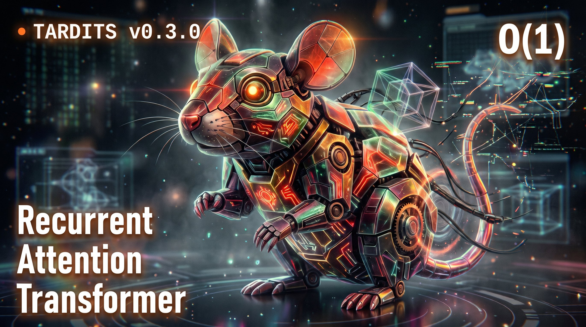
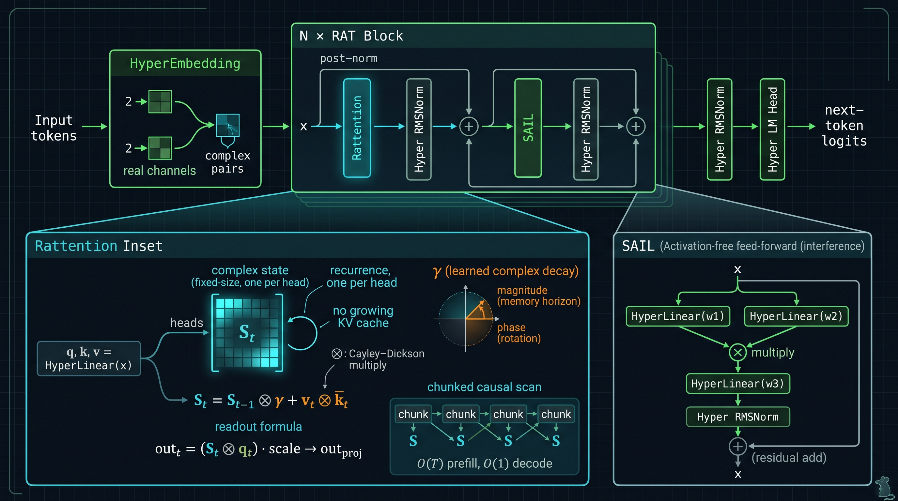
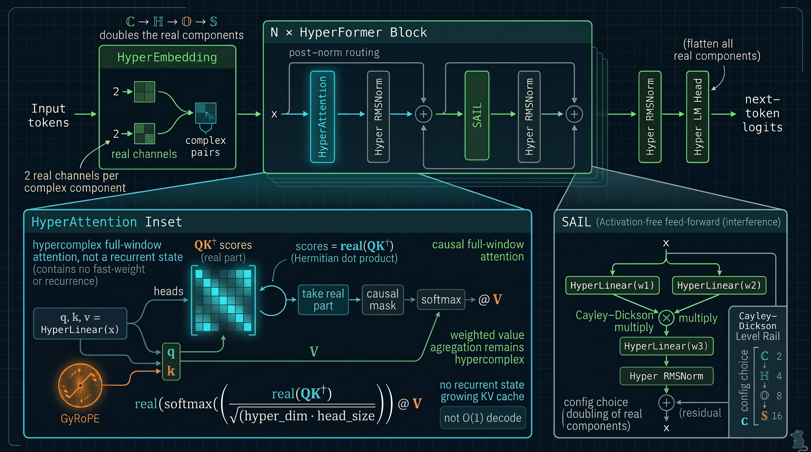
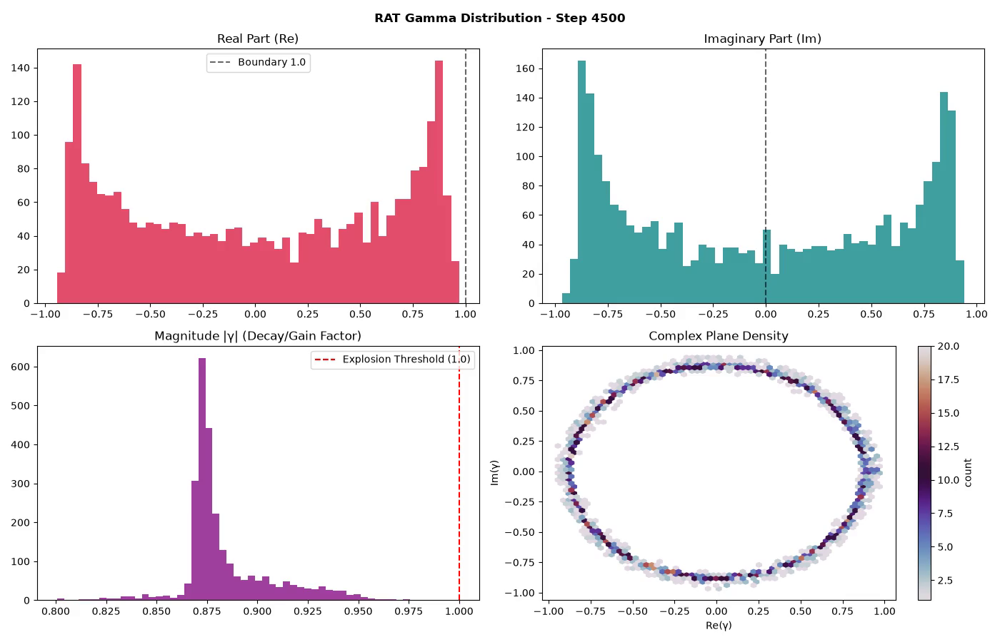
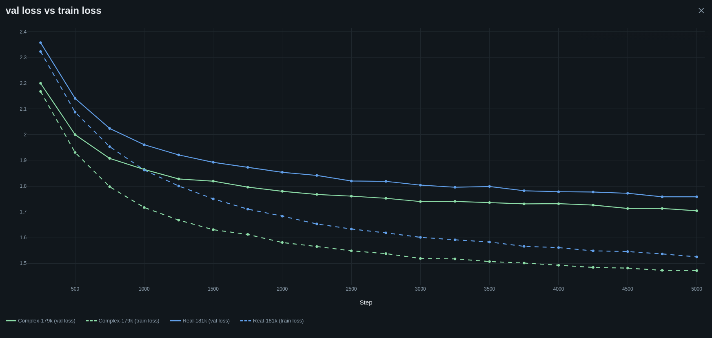
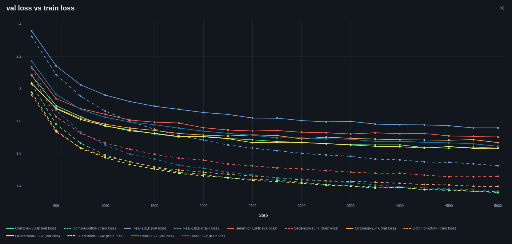
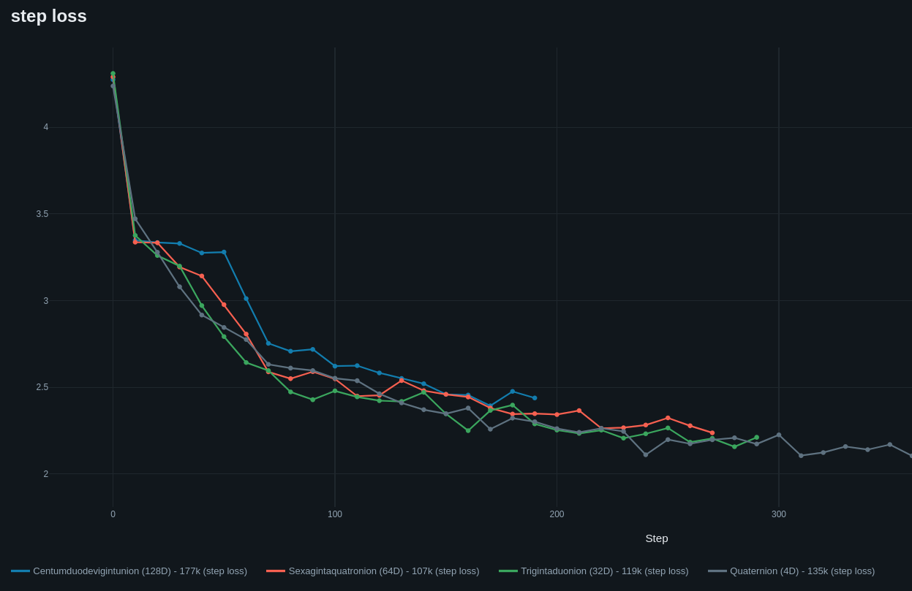

<div align="center">
  
# Text And Rotating Dimensions In Token Space<br><sup><small>*или: как сделать языковые модели больше внутри*</small></sup>

🇬🇧 [English](README.md) | 🇩🇪 [Deutsch](README.de.md) | 🇨🇿 [Čeština](README.cs.md) | 🇨🇳 [中文](README.zh.md) | 🇷🇺 **Русский**

<a href="https://git.pvlb.dev/ml-lab/tardits"> Домашний репозиторий - https://git.pvlb.dev/ml-lab/tardits</a><br>
<small><Зеркало GitHub: <a href="https://github.com/pvlb-dev/tardits" target="_blank">https://github.com/pvlb-dev/tardits</a>></small>

> Это русский перевод README для версии v0.3.0. Каноническим источником остаётся английский [README.md](README.md); при любых расхождениях ориентируйтесь на него.

---

</div>
<br>


### Добро пожаловать в **TARDITS**, небольшую лабораторию комплекснозначных языковых моделей!

**v0.3.0 добавляет RAT** - это *Recurrent Attention Transformer*: softmax-внимание
заменяется линейной памятью с быстрыми весами (fast-weight) и обучаемым
комплексным затуханием. Состояние имеет фиксированный размер, генерация стоит
O(1) на токен, а KV-кэш не растёт. Это другой компромисс, а не бесплатная
победа: при подобранном LR **RAT33 идёт вровень с RealGPT 48M по средней
валидационной потере на FineWeb, имея на 31% меньше параметров**, а RAT
значительно быстрее при длинном декодировании контекста. У обеих по-прежнему
есть явные ограничения по извлечению (retrieval) и интерпретируемости. Честные
результаты, включая нулевые (null), приведены по ссылкам ниже.

<p align="center">

</p>

> Таблица доказательств v0.3.0 и честные ограничения находятся в
> [docs/index.md](docs/index.md). Запуски на FineWeb, повторный запуск с
> исправленным порядком данных и сравнение RAT с Real заменяют старую историю
> только про Шекспира.
> Документация по RAT/HyperFormer и более крупные запуски ещё впереди; этот
> релиз - отправная точка, а не последнее слово.


<details>
<summary><b>Как всё начиналось</b> - история v0.0.0 🔻</summary>

<br>

TARDITS начался как мой вариант замечательного туториала
[Let's build GPT](https://youtu.be/kCc8FmEb1nY?si=I0z2-jByJj_6_QIH). Закончив
свою GPT-сеть и обновив её (RoPE, SwiGLU, RMSNorm...), я задумался о том, чтобы
написать комплексный трансформер. В основном потому, что спросил себя:
*действительно* ли им нужна функция активации... как выяснилось, **не нужна 🤯**

После нескольких итераций $\mathbb{C}$-сеть стала на удивление стабильной.
Конечно, дальше нужно было попробовать кватернионы ($\mathbb{H}$). Они
строились с помощью конструкции Кэли-Диксона: я пропускаю 2 комплексных
значения через трансформер и позволяю PyTorch сделать всю работу с обратным
распространением. Затем концепция немного вышла из-под контроля, и сети на
октанионах ($\mathbb{O}$) и седенионах ($\mathbb{S}$) тоже как-то появились.
Обе работают, но обучаются очень долго. Особенно на CPU :D

Возможно, у CVNN есть применения получше, чем предсказание текста... но почему
бы не Шекспир?

</details>

---

<br>


## 🙃 Архитектура
<details>
<summary><b>Нажмите, чтобы развернуть 🔻</b></summary>

### 🐀 v0.3.0 - RAT (текущая)

<p align="center">

</p>

*Блок RAT. `Rattention` хранит комплексное состояние быстрых весов фиксированного
размера с обучаемым затуханием `γ`; `SAIL` - путь прямой связи без активаций.*

RAT заменяет softmax/KV-путь линейной памятью с быстрыми весами:

```
S_t = S_{t-1} ⊗ gamma + v_t ⊗ conjugate(k_t)
out_t = (S_t ⊗ q_t) * scale -> out_proj
```

`gamma` обучается для каждого элемента состояния; её модуль задаёт горизонт
памяти, а фаза вращает ассоциации. Это прототип `LinA`, интегрированный в `tardits`.

**Что в нём особенного**

- **Состояние фиксированного размера:** декодирование стоит O(1) на токен, а
  растущего KV-кэша нет; prefill - O(T) с чанковым причинным сканированием.
- **Память и позиция в одном параметре:** комплексное затухание несёт в себе и
  горизонт забывания, и относительную фазу; отдельной таблицы абсолютных
  позиций нет.
- **Без активаций:** тот же блок SAIL и стек гиперкомплексных эмбеддингов
  работают без активации в MLP.
- **Честные ограничения:** при 11M-45M параметров RAT конкурентоспособен на
  FineWeb и значительно быстрее при длинном декодировании. NIAH/retrieval - чистый
  нулевой результат (null) для **обеих моделей, RAT и RealGPT**, при текущих
  масштабах; масштабирование и улучшенные тесты NIAH в работе. Пробы
  триггеров/гейтинга - исследовательские заметки, а не возможности.

### 🧬 v0.2.0 - HyperFormer

<p align="center">

</p>

*Блок HyperFormer. GyRoPE вращает q/k, оценки используют действительную часть
эрмитова произведения, а веса внимания остаются действительными, тогда как
значения остаются гиперкомплексными.*

HyperFormer - предшественник и общий гиперкомплексный путь: один и тот же блок
инстанцируется на уровнях Кэли-Диксона ℂ, ℍ, 𝕆 и 𝕊. Он сохраняет причинное
внимание по всему окну (в текущей реализации без KV-кэша и без заявки на
O(1)-декодирование), использует GyRoPE для позиции и берёт действительную часть
`QK†` как оценку softmax.

### 🧩 Модули

#### ⛵ SAIL (Self-Activating Interference Layer)
В стандартных $\mathbb{R}$-сетях нелинейные функции активации в слое прямой
связи строго необходимы. Комплексный линейный слой всё равно остаётся линейным;
нелинейность в **SAIL** возникает из перемножения **двух проекций одного и того
же входа**:
`SAIL(z) = (W₁z) ⊗ (W₂z)`, что является квадратичной операцией. По сути это
SwiGLU без «Swi»: разбиение двумя линейными слоями, гиперкомплексное
перемножение, затем проекция. В сочетании с остаточными связями
`z = z + SAIL(z)` этого достаточно для обучаемого комплексного трансформера.

#### 🪢 GyRoPE - обучаемый RoPE, полный круг
Пока я ~~реализовывал~~ экспериментировал с RoPE в своей $\mathbb{R}$-сети, я обнаружил, что
обучаемый RoPE, инициализированный случайно от $ -2\pi$ до $2\pi$, оказался
сопоставим с классическими позиционными кодированиями. Он хорошо работает с
комплексными трансформерами, хотя весов немного и они меняются медленно.

* $\mathbb{C}$-RoPE вращается в комплексной плоскости $2\mathcal{D}$.
* $\mathbb{H}$-RoPE вращается вокруг единичной 3-сферы ($S^3$).
* $\mathbb{O}$ и $\mathbb{S}$ вращаются вокруг соответствующих гиперсферических аналогов.

#### 👀 HyperAttention
Как организовать внимание в комплексных пространствах? **Побеждает простота.**
Оценки используют эрмитово скалярное произведение ($Q K^\dagger$); берётся
только **действительная компонента**, применяются причинная маска и обычный
softmax:

```python
# In C-Space:
wei = (q @ k.adjoint()) * (2 * self.head_size) ** -0.5
wei = wei.real
wei = F.softmax(wei.masked_fill(self.tril[:T, :T] == 0, float("-inf")), dim=-1)
# Weighted value aggregation remains hypercomplex:
out = wei.to(v.dtype) @ v
```

Действительная часть отражает согласование фаз и величину, выступая скалярной
оценкой сходства; затем действительные веса масштабируют полные гиперкомплексные
векторы значений.

#### 🐀 Rattention
`Rattention` - это линейный модуль быстрых весов: проекции q/k/v, комплексное
состояние на каждую голову, `S_t = S_{t-1} ⊗ γ + v_t ⊗ k̄_t` и чтение
`(S_t ⊗ q_t)·scale`. `forward` (обучение) и рекуррентный `step` (генерация)
проверяются тестами друг против друга.

#### 🏋️ Инициализация весов
Веса внимания и SAIL инициализируются около единичной окружности/сферы и
масштабируются на:

$$\sqrt{\frac{S}{d_{in} + d_{out}}}$$

где $S$ равно $\mathbb{C}=1.0$, $\mathbb{H}=0.5$, $\mathbb{O}=0.25$, $\mathbb{S}=0.125$.

#### 🛌 Эмбеддинги и LM-Head
Токены отображаются в комплексный гиперкомплексный тензор с одной парой
действительная/мнимая на каждую комплексную компоненту; LM-head разворачивает
все действительные/мнимые компоненты обратно в логиты $\mathbb{R}$.

#### 🛡️ RMSNorm - нормировка амплитуд с сохранением фаз
🧨 уберите при взрывных шумах трансформера (NaN) 💥

Стандартная нормализация может искажать геометрическую информацию о фазах в
комплексных пространствах. Собственный **RMSNorm** вычисляет RMS по модулям
векторов ($\Vert q\Vert^2 = |z_1|^2 + |z_2|^2$) и масштабирует амплитуды,
оставляя фазы нетронутыми.

<br>
<br>

</details>

## 🔥 Горячие кривые (бенчмарки и результаты)
<details>
<summary><b>Нажмите, чтобы развернуть 🔻</b></summary>

<br>

### 🌊 Паттерны интерференции SAIL ($\mathbb{C}$)

#### 🎬 Эволюция 2D-интерференции SAIL
[](https://www.youtube.com/watch?v=nFiWQWMtX-Q)
[](https://youtube.com/shorts/OIvpBzp8Y8c?si=LPVmYf6Skw9IRELd)

#### 🎬 Топография фазы и амплитуды 3D SAIL
[](https://youtu.be/r6ykSiY3ipY?si=VosKe4IpfWTy1jbz)
[](https://youtube.com/shorts/7kjrDF7-UUg?si=jcLONq29jUDC2mVX)

*Рисунок: эволюция избирательной фазовой интерференции по всем 8 слоям Transformer за шаги обучения. Глубокие слои (6 и 7) демонстрируют экстремальное деструктивное гашение фаз вместе с очень острыми резонансными пиками (> 10,000 амплитуды). Именно поэтому Post-Norm дизайн здесь имеет большой смысл*

<br>

### 🧪 FineWeb - RAT против RealGPT

Char-level FineWeb, 90.1M символов на вариант, block 1024, batch 4. Строки - по
22k итераций, если не указано иное; все используют исправление порядка данных.
Строки RAT L1 обучены со стабильным сканированием из #23.

| модель | lr | шаги | параметры | символов/параметр | val loss | примечание |
|---|---:|---:|---:|---:|---:|---|
| **RAT L1 33.4M** | 3e-4 | 34k | 33.37M | 4.2 | **1.2357 / 1.2364** | среднее **1.2361**, два сида |
| **RealGPT 48.1M** | 1e-4 | 36k | 48.09M | 3.1 | **1.2485 / 1.2225** | среднее **1.2355**, два сида |
| RAT L1 33.4M (22k) | 3e-4 | 22k | 33.37M | 2.7 | 1.2540 / 1.2902 | более старый короткий запуск |
| RAT L1 44.8M | 3e-4 | 22k | 44.76M | 2.0 | 1.2911 | 1.6× wall-clock относительно Real |
| RAT L1 11.2M | 3e-4 | 22k | 11.24M | 8.0 | 1.2845 | повторный запуск с исправленным порядком данных |
| RealGPT 11.1M | 3e-4 | 22k | 11.13M | 8.1 | 1.3253 | повторный запуск с исправленным порядком данных |
| HyperFormer 11.2M | 3e-4 | 22k | 11.2M | 8.0 | 1.2950 | контроль с 8 головами |
| RAT 6.47M | 3e-4 | 22k | 6.47M | 13.9 | 1.3669 | точка деградации |
| RealGPT 48.1M (старый) | 3e-4 | 22k | 48.09M | 1.9 | 1.5523 | та же модель, неверный LR |

**При подобранном LR и сопоставимом бюджете RAT33 и Real48 идут вровень по
средней val**: 1.2361 против 1.2355, разница 0.0006. RAT33 достигает этого,
**имея на 31% меньше параметров**, но два его сида почти идентичны (разброс
0.0007), тогда как разброс Real - ~0.026. Честное утверждение - **паритет /
параметрическая эффективность**, а не «RAT побеждает» или «Real побеждает».

Поиск LR в итоге был симметричным: для Real48 1e-4 оказался лучше 3e-4/5e-4; для
RAT33 3e-4 оказался лучше 1e-4. Более ранние сравнения Real с RAT, использовавшие
3e-4 с обеих сторон, были искажены влиянием LR. Однако RAT44 зависит от ширины
и не является контролем с неверным LR: 1e-4 помог ему (3e-4 1.2911 -> 1e-4
1.2675 на 26.5k), тогда как 1e-4 навредил RAT33 (1.2874) и RAT22 (1.3199).

Оговорка: бюджеты токенов близки: RAT 34k x 1024 x 4 = 139.3M символов,
Real 147.5M. Извлечение за пределами окна - чистый нулевой результат для **обеих**
моделей при этих масштабах ([NIAH](docs/findings/niah-fineweb.md)); масштабирование
и улучшенные тесты NIAH в работе, поэтому заявления о длинном контексте пока
касаются только скорости.

#### 📈 Масштабирование ширины

<p align="center">

</p>

*Свип ширины при 9 слоях. 11.2M - неожиданная точка: внутри диапазона сидов 33M
и на одном уровне с 44M в этом запуске; 6.47M деградирует. Точка 11M в таблице
выше - более поздний повторный запуск с исправленным порядком данных, поэтому
кривые дают направление, а не ещё одну копию сида.*

### 🧠 Что RAT делает хорошо (исследовательский превью)

Крошечный RAT на 143k параметров, обученный на одном случайном тексте длиной
512 символов, воспроизводит **всю оставшуюся строку** по промпту в 16 или 32
символа (teacher-forced accuracy 0.996-0.998), тогда как сопоставимый по размеру RealGPT
ошибается сразу за пределами обученного блока. Это эффект относительной позиции
/ рекуррентного состояния, а не общая способность к длинному контексту: контроль
NIAH на соседнее копирование по-прежнему проваливается, а проверка триггера с
чистым пространством имён показывает, что RAT может запомнить полезную нагрузку,
но не может надёжно срабатывать по триггеру. Полная история, включая проваленные
контроли, в
[`docs/experiments/2026-11-04-memorize.md`](docs/experiments/2026-11-04-memorize.md)
и [`docs/experiments/2026-11-05-trigger.md`](docs/experiments/2026-11-05-trigger.md).
Более крупные запуски и дополнительная документация по RAT в работе.

### ⚡ Скорость декодирования

<p align="center">

</p>

*Только декодирование, бейзлайн - RealGPT с KV-кэшем. Это более старый
мелкомасштабный (0.9M) бенчмарк на Шекспире: RAT L1 примерно плоский
(~317-363 tok/s), тогда как RealGPT падает с ~392 до ~215 tok/s на 16→2048.
Числа для больших моделей на T4/CPU - ниже.*

#### Пропускная способность и память больших моделей (B=8, 2048 токенов)

<p align="center">

</p>

| модель | decode tok/s | пиковый объём, ГБ | относительно памяти Real |
|---|---:|---:|---:|
| **RAT22** | **782** | **0.48** | **~7.1× меньше** |
| RAT33 | 624 | 0.62 | ~5.5× меньше |
| RAT44 | 621 | 0.66 | ~5.2× меньше |
| Real48 | 487 | 3.43 | 1× |

Это компромисс в одной таблице: при single-stream/коротком контексте Real48
быстрее (96 против 77 tok/s), а RAT44 медленнее, но при batch 8 / 2048 RAT33/44
примерно в 1.25× быстрее **и используют пятую часть объёма памяти**. RAT22 -
победитель по пропускной способности при одной седьмой объёма памяти, с более
слабым качеством. См. [полный отчёт о скорости](docs/experiments/2026-11-08-inference-speed-big.md).

### 🎚️ Обучаемое затухание

<p align="center">

</p>

*Выученный `|γ|` по слоям в финальном чекпоинте L1 shakespeare: модель выбирает
короткие горизонты (~8-13 токенов), а не одно глобальное затухание. Маленькая
модель на крошечных данных, но это показывает, что параметр действительно
работает; аудит длинного контекста/состояния - в
[RAT decay](docs/findings/rat-decay.md) и
[state probe](docs/findings/rat-state-probe.md).*

<p align="center">

</p>

*Кадр-постер из видео эволюции обучаемого затухания; MP4 доступен по ссылке из
[документации](docs/index.md).*

### 📉 Запуски на Шекспире (старые)

общие параметры:

| batch_size | block_size | dropout | learning rate | vocab_size |
| :--------- | :--------: | :-----: | :-----------: | ---------- |
| 32         |    128     |   0.2   |    0.0005     | 65         |

#### $\mathbb{C}$ против $\mathbb{R}$ / оба ~180k параметров


| Модель         | Пространство | $n_{embd}$ | Слои   | Головы | Параметры | Train Loss | Val Loss  |
| :------------- | :----------: | :--------: | :----: | :---: | :----: | :--------: | :-------: |
| **ComplexGPT** | $\mathbb{C}$ |     54     |   4    |   6   | ~179k  | **1.472**  | **1.704** |
| **RealGPT**    | $\mathbb{R}$ |     60     |   4    |   6   | ~181k  |   1.526    |   1.759   |

#### $\mathbb{R}$ против остальных комплексных

Количество параметров масштабировано. Примечание: запуски большей размерности занимают *целую вечность*. «Седениону» нужно 256 умножений вместо одного.


*Рисунок: траектории потерь при обучении и валидации по пространствам ($\mathbb{R}, \mathbb{C}, \mathbb{H}, \mathbb{O}, \mathbb{S}$). Обратите внимание, как Complex-383k (зелёный) стабильно превосходит более крупный Real-бейзлайн (синий).*

| Модель            | Пространство | $n_{embd}$ | Слои   | Головы | Параметры | Train Loss | Val Loss  |
| :---------------- | :----------: | :--------: | :----: | :---: | :----: | :--------: | :-------: |
| **RealGPT**       | $\mathbb{R}$ |     96     |   5    |   6   | ~567k  |   1.367    |   1.645   |
| **ComplexGPT**    | $\mathbb{C}$ |     72     |   5    |   6   | ~384k  | **1.359**  |   1.633   |
| **QuaternionGPT** | $\mathbb{H}$ |     54     |   4    |   4   | ~356k  |   1.367    | **1.633** |
| **OctonionGPT**   | $\mathbb{O}$ |     32     |   4    |   4   | ~264k  |   1.398    |   1.668   |
| **SedenionGPT**   | $\mathbb{S}$ |     18     |   4    |   6   | ~184k  |   1.460    |   1.702   |

<br>

<details>
<summary><b>Бонус v0.2.0 - Centumduodevigintunions 🔻</b></summary>

Это нелепо, бессмысленно, и я даже не могу это выговорить... но оно работает (очень медленно). Самые интересные применения, вероятно, на уровнях 1-3 ;)
</details>

<br><br>


</details>


## 🚀 Быстрый старт и использование


### Установка

```bash
pip install tardits
# or
uv add tardits
```

Опционально - для отслеживания экспериментов в [MLFlow](https://github.com/mlflow/mlflow):

```bash
pip install tardits[mlflow]
```

### Быстрый старт

#### Пример конфигурации (сохраните как .yaml):
```yaml
device: "auto" # Choices: "auto", "cuda", "cpu", "mps"
seed: 1337

model:
  arch: hyper # optional: real | hyper | rat (default: level < 1 -> real, else hyper)
  level: 1 # Complex
  block_size: 64
  n_head: 6
  n_embd: 42
  n_layer: 4
  dropout: 0.2

trainer:
  batch_size: 32
  max_iters: 5000
  eval_interval: 500
  learning_rate: 0.0005
  eval_iters: 200
  save_interval: 0
  checkpoint: "saved_model.pt"

mlflow:
  experiment: "" # add name to enable
  log_interval: 10
  deep_log_interval: 0
  system_metrics: false

data:
  input_path: "my_training_data.txt"
  vocab_save_path: "saved/charset.txt"
```
Вы также можете взять конфиг из [examples/configs] и shakespeare.txt из [examples/data]

#### Вариант RAT

Замените блок модели; тренер и `tgen` не меняются:

```yaml
model:
  arch: rat
  level: 1             # complex
  block_size: 128
  n_head: 21
  n_embd: 84
  n_layer: 8
  dropout: 0.2
```

Эталонные конфиги FineWeb находятся в
`experiments/configs/fineweb/` (RAT 11M/33M/45M).

#### Запуск обучения
```bash
ttrain -c config.yaml
```

#### Генерация текста
```bash
tgen -c config.yaml -p "To be or not to be" -l 200

tgen -h
options:
  -h, --help            show this help message and exit
  --config, -c CONFIG   Path to YAML configuration file
  --arch, -a ARCH       Override the model family selected in the config
                        (hyper | rat | real)
  --checkpoint CHECKPOINT
                        Optional override for model checkpoint path
  --vocab VOCAB         Optional override for vocab path
  --prompt, -p PROMPT   Text prompt to start generation
  --length, -l LENGTH   Number of tokens to generate
  --temp, -t TEMP       Model sampling temperature
  --top_k, -k TOP_K     Top-k sampling threshold
  --follow, -f          Endless stream of tokens
  --delay DELAY         Delay between tokens in follow mode (seconds)
```


### v0.3.0 (текущий релиз) - RAT
- [x] **RAT (`arch: rat`):** линейная память с быстрыми весами, обучаемое комплексное затухание, O(1)-декодирование, чанковый причинный prefill.
- [x] **Порт RAT + тесты:** эквивалентность `forward`/`step`, prefill/generate, регрессия сканирования с обучаемой gamma, все архитектуры.
- [x] **Доказательства на FineWeb:** RAT 11M/33M/45M против RealGPT 11M/48M, включая повторный запуск с исправленным порядком данных и симметричный подход к LR: RAT33 3e-4/34k среднее 1.2361 против Real48 1e-4/36k среднее 1.2355, при этом у RAT на 31% меньше параметров. Исторические строки RAT L1 относятся ко времени до #23; пара длинных запусков RAT33 чиста по #23.
- [x] **Текущие нулевые результаты:** контроль NIAH на соседнее копирование проваливается и для RAT, и для RealGPT; масштабирование и улучшенные тесты NIAH в работе, поэтому заявлений об извлечении на длинном контексте пока нет.
- [x] **CLI + конфиги:** `ttrain` / `tgen` для real, hyper, rat; отслеживание в MLflow.
- [ ] **PyPI 0.3.0:** перенос релизного репозитория отслеживается в #1.

<br>


## 🧭 Планы
- **Диффузия текста:** ставка на 0.4.0 - модель текстовой диффузии с RAT- и гиперкомплексными вариантами, а не ещё один релиз только для авторегрессии.
- **Дистилляция с перехватом (hijack):** замороженные эмбеддинги/голова учителя + ядро RAT; пробы logit-KL и hidden-MSE (исследование; не функция 0.3.0).
- **Статья:** метод RAT + доказательства на FineWeb + нулевые результаты (`paper/`, после релиза).
