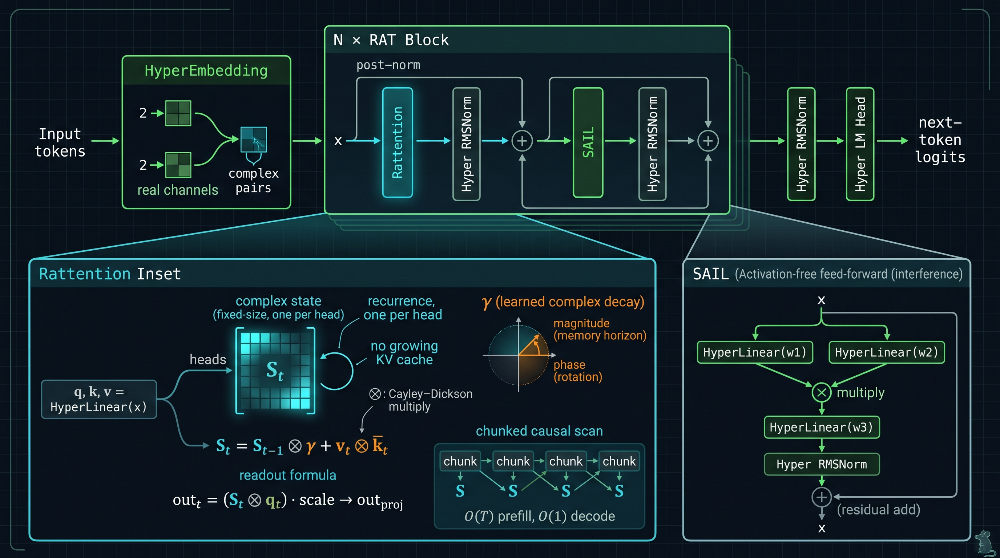
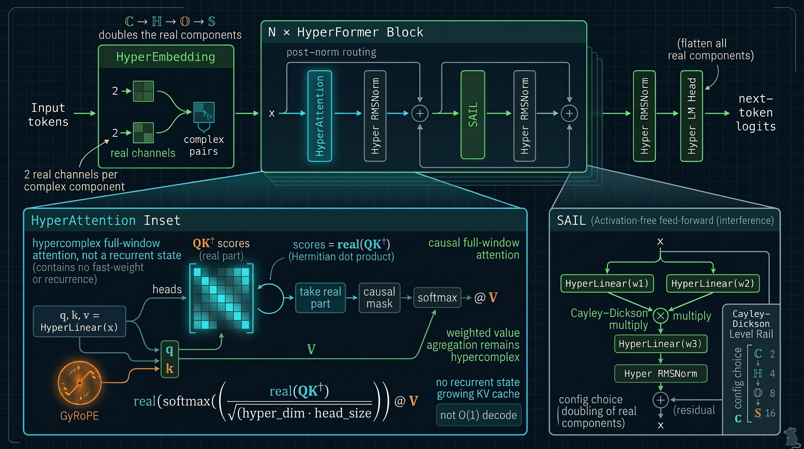
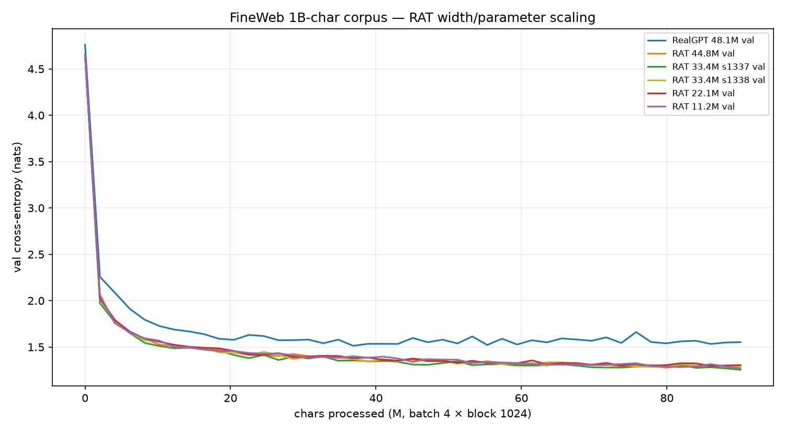
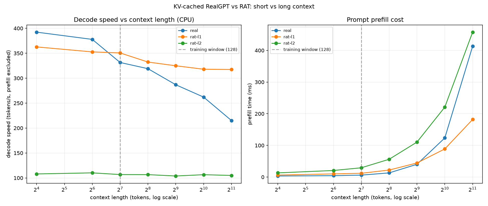
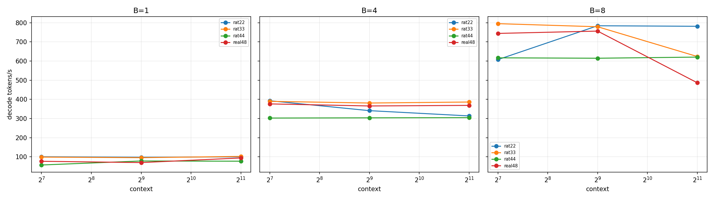
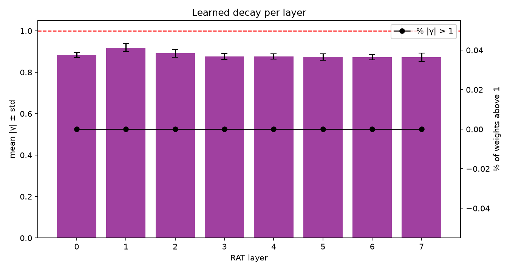
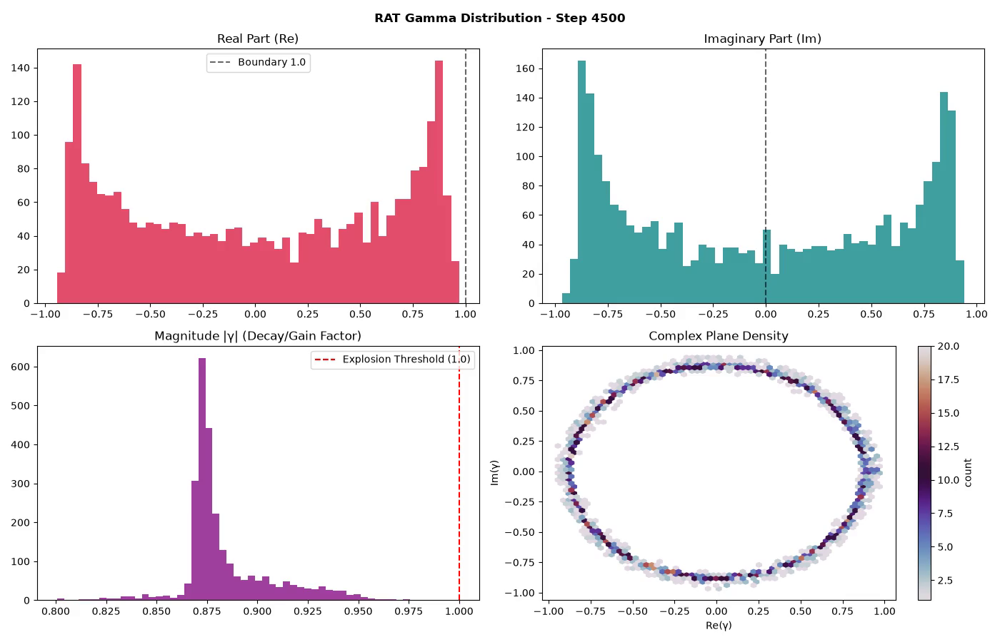
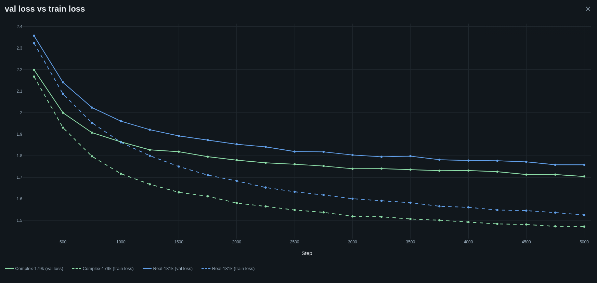
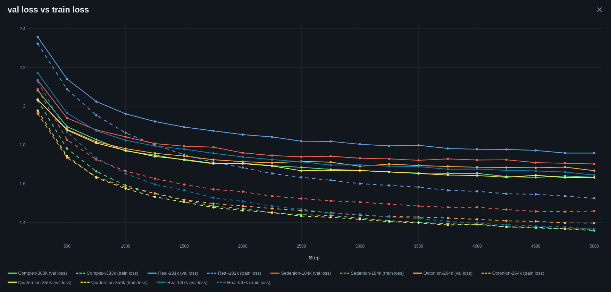
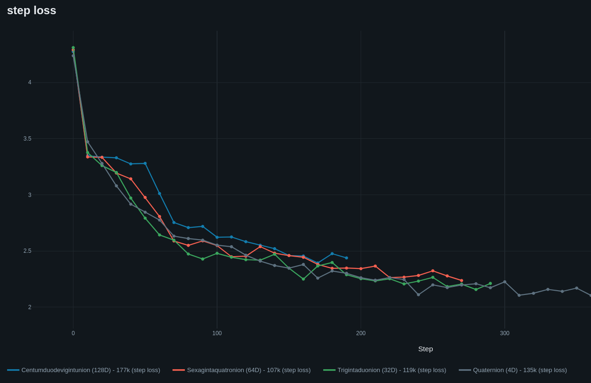

<div align="center">
  
# Text And Rotating Dimensions In Token Space<br><sup><small>*或者：如何让语言模型的内部更大*</small></sup>

🇬🇧 [English](README.md) | 🇩🇪 [Deutsch](README.de.md) | 🇨🇿 [Čeština](README.cs.md) | 🇨🇳 **中文** | 🇷🇺 [Русский](README.ru.md)

<a href="https://git.pvlb.dev/ml-lab/tardits"> 主仓库 - https://git.pvlb.dev/ml-lab/tardits</a><br>
<small><GitHub 镜像: <a href="https://github.com/pvlb-dev/tardits" target="_blank">https://github.com/pvlb-dev/tardits</a>></small>

> 本文是 v0.3.0 的简体中文译本；英文 README 为权威版本，请以 [README.md](README.md) 为准。

---

</div>
<br>


### 欢迎来到 **TARDITS**，一个研究复值语言模型的小实验室！

**v0.3.0 加入 RAT** - 一个 *Recurrent Attention Transformer*：softmax 注意力被替换为带有可学习复数衰减的线性 fast-weight 记忆。状态大小固定，生成是每 token O(1)，并且没有 KV-cache 增长。这是一种不同的权衡，而不是免费的胜利：在调好的学习率下，**RAT33 在 FineWeb 平均验证损失上与 48M RealGPT 打平，且参数少 31%**，同时 RAT 在长上下文解码上快得多。两者仍然有明确的检索与可解释性局限。诚实的结果，包括那些零结果，都链接在下面。

<p align="center">

</p>

> v0.3.0 的证据表与诚实的局限见
> [docs/index.md](docs/index.md)。FineWeb 运行、数据顺序重跑以及
> RAT 与 Real 的对比取代了旧的仅限 Shakespeare 的叙事。
> 更多 RAT/HyperFormer 文档与更大规模的运行正在路上；本次发布是
> 起点，而不是最终结论。


<details>
<summary><b>它是如何开始的</b> - v0.0.0 的故事 🔻</summary>

<br>

TARDITS 最初是我对超棒的
[Let's build GPT](https://youtu.be/kCc8FmEb1nY?si=I0z2-jByJj_6_QIH) 教程的尝试。在
完成我的 GPT-net 并不断更新它（RoPE、SwiGLU、RMSNorm……）之后，我萌生了写一个
复数 transformer 的想法。主要因为我问自己：它们*真的*需要激活函数吗……结果发现
**它们不需要 🤯**

经过几次迭代，$\mathbb{C}$-net 变得出奇地稳定。当然，接下来我必须试试四元数
（$\mathbb{H}$）。它们是用 Cayley–Dickson 构造搭建的 - 所以我把 2 个复数值送进
transformer，让 PyTorch 完成所有反向传播工作。然后这个概念有点失控，八元数
（$\mathbb{O}$）和十六元数（$\mathbb{S}$）网络也莫名其妙地出现了。两者都能跑，
但训练要花非常长的时间。尤其是在 CPU 上 :D

CVNN 或许有比预测文本更好的用途……但为什么不用 Shakespeare 呢？

</details>

---

<br>


## 🙃 架构
<details>
<summary><b>点击展开 🔻</b></summary>

### 🐀 v0.3.0 - RAT（当前）

<p align="center">

</p>

*RAT 模块。`Rattention` 维护一个固定大小的复值 fast-weight 状态，其衰减 `γ` 可学习；`SAIL` 是无激活函数的前馈通路。*

RAT 用线性 fast-weight 记忆取代 softmax/KV 路径：

```
S_t = S_{t-1} ⊗ gamma + v_t ⊗ conjugate(k_t)
out_t = (S_t ⊗ q_t) * scale -> out_proj
```

`gamma` 按状态元素逐个学习；其幅值是记忆视野，其相位旋转联想。这就是集成进 `tardits` 的 `LinA` 原型。

**它的特别之处**

- **固定大小的状态：** 解码是每 token O(1)，没有不断增长的 KV cache；
  prefill 借助分块因果扫描是 O(T)。
- **记忆与位置合于一个参数：** 复数衰减同时承载遗忘视野与相对相位；无需单独的
  绝对位置表。
- **无激活函数：** 同一 SAIL 模块与超复数嵌入栈无需 MLP 激活即可工作。
- **诚实的局限：** 在 11M–45M 参数下，RAT 在 FineWeb 上具有竞争力，并且在长
  解码时快得多。在当前的规模下，NIAH/检索对 **RAT 和 RealGPT** 都是干净的
  零结果；扩展与更好的 NIAH 测试正在进行。触发/门控探针只是研究笔记，不是
  能力。

### 🧬 v0.2.0 - HyperFormer

<p align="center">

</p>

*HyperFormer 模块。GyRoPE 旋转 q/k，得分使用 Hermitian 乘积的实部，注意力权重保持实数，而值保持超复数。*

HyperFormer 是前身，也是通用的超复数路径：同一个模块在 Cayley–Dickson 层级
ℂ、ℍ、𝕆 和 𝕊 上实例化。它保留因果全窗口注意力（当前实现中没有 KV cache，
也不声称 O(1) 解码），用 GyRoPE 表示位置，并取 `QK†` 的实部作为 softmax 得分。

### 🧩 模块

#### ⛵ SAIL (Self-Activating Interference Layer)
在标准 $\mathbb{R}$-net 中，前馈层里的非线性激活函数是严格必需的。复线性层依然
是线性的；**SAIL** 中的非线性来自把**同一输入的两个投影**相乘：
`SAIL(z) = (W₁z) ⊗ (W₂z)`，这是二次的。它本质上就是去掉 "Swi" 的 SwiGLU：
经两个线性层拆分，做超复数乘法，然后投影。配合残差连接 `z = z + SAIL(z)`，
这足以构成一个可训练的复数 transformer。

#### 🪢 GyRoPE - 可学习的 RoPE，完整圆周
在我的 $\mathbb{R}$-net 中~~实现~~试验 RoPE 时，我发现从 $ -2\pi$ 到 $2\pi$
随机初始化、可训练的 RoPE 能与经典位置编码相媲美。它与复数 transformer 配合得
很好，尽管权重很少且变化缓慢。

* $\mathbb{C}$-RoPE 在 $2\mathcal{D}$ 复平面内旋转。
* $\mathbb{H}$-RoPE 绕单位 3-球面（$S^3$）旋转。
* $\mathbb{O}$ 和 $\mathbb{S}$ 绕各自对应的超球面旋转。

#### 👀 HyperAttention
如何在复空间中路由注意力？**简单胜出。** 得分使用 Hermitian 点积
（$Q K^\dagger$）；只取**实部**，应用因果掩码与标准 softmax：

```python
# In C-Space:
wei = (q @ k.adjoint()) * (2 * self.head_size) ** -0.5
wei = wei.real
wei = F.softmax(wei.masked_fill(self.tril[:T, :T] == 0, float("-inf")), dim=-1)
# Weighted value aggregation remains hypercomplex:
out = wei.to(v.dtype) @ v
```

实部捕获相位对齐与幅值，充当标量亲和度得分；随后的实值权重对整个超复数 value
向量进行缩放。

#### 🐀 Rattention
`Rattention` 是线性 fast-weight 模块：q/k/v 投影、每头一个复数状态、
`S_t = S_{t-1} ⊗ γ + v_t ⊗ k̄_t`，以及读出 `(S_t ⊗ q_t)·scale`。
`forward`（训练）与循环式 `step`（生成）由测试交叉校验。

#### 🏋️ 权重初始化
注意力和 SAIL 的权重围绕单位圆/球面初始化，并按以下公式缩放：

$$\sqrt{\frac{S}{d_{in} + d_{out}}}$$

其中 $S$ 为 $\mathbb{C}=1.0$、$\mathbb{H}=0.5$、$\mathbb{O}=0.25$、$\mathbb{S}=0.125$。

#### 🛌 嵌入与 LM-Head
Token 映射为一个复值超复数张量，每个复数分量对应一对实/虚部；LM head 把所有
实/虚分量展平回 $\mathbb{R}$ logits。

#### 🛡️ RMSNorm - 归一化幅值，保留相位
🧨 若移除，transformer 噪声会爆炸（NaN）💥

标准归一化可能扭曲复空间中的几何相位信息。自定义的 **RMSNorm** 从向量幅值计算
RMS（$\Vert q\Vert^2 = |z_1|^2 + |z_2|^2$），并重新缩放幅值而保持相位不变。

<br>
<br>

</details>

## 🔥 热门曲线（基准与结果）
<details>
<summary><b>点击展开 🔻</b></summary>

<br>

### 🌊 SAIL 干涉图案（$\mathbb{C}$）

#### 🎬 2D SAIL 干涉演化
[](https://www.youtube.com/watch?v=nFiWQWMtX-Q)
[](https://youtube.com/shorts/OIvpBzp8Y8c?si=LPVmYf6Skw9IRELd)

#### 🎬 3D SAIL 相位-幅值地形图
[](https://youtu.be/r6ykSiY3ipY?si=VosKe4IpfWTy1jbz)
[](https://youtube.com/shorts/7kjrDF7-UUg?si=jcLONq29jUDC2mVX)

*图：训练过程中全部 8 个 Transformer 层里选择性相位干涉的演化。深层（6 和 7）表现出极端的破坏性相位抵消，同时伴随极其尖锐的共振峰（幅值 > 10,000）。这就是 Post-Norm 设计在这里非常合理的原因*

<br>

### 🧪 FineWeb - RAT vs RealGPT

字符级 FineWeb，每臂 90.1M 字符，block 1024，batch 4。各行均为 22k 次迭代，
除非另有说明；所有行都使用数据顺序修复。RAT L1 各行使用稳定的 #23 扫描训练。

| 模型 | lr | 步数 | 参数 | chars/param | val loss | 备注 |
|---|---:|---:|---:|---:|---:|---|
| **RAT L1 33.4M** | 3e-4 | 34k | 33.37M | 4.2 | **1.2357 / 1.2364** | 均值 **1.2361**，两个 seed |
| **RealGPT 48.1M** | 1e-4 | 36k | 48.09M | 3.1 | **1.2485 / 1.2225** | 均值 **1.2355**，两个 seed |
| RAT L1 33.4M (22k) | 3e-4 | 22k | 33.37M | 2.7 | 1.2540 / 1.2902 | 较早的短程运行 |
| RAT L1 44.8M | 3e-4 | 22k | 44.76M | 2.0 | 1.2911 | 相对 Real 为 1.6× wall-clock |
| RAT L1 11.2M | 3e-4 | 22k | 11.24M | 8.0 | 1.2845 | 修复数据顺序后的重跑 |
| RealGPT 11.1M | 3e-4 | 22k | 11.13M | 8.1 | 1.3253 | 修复数据顺序后的重跑 |
| HyperFormer 11.2M | 3e-4 | 22k | 11.2M | 8.0 | 1.2950 | 8 头对照组 |
| RAT 6.47M | 3e-4 | 22k | 6.47M | 13.9 | 1.3669 | 退化点 |
| RealGPT 48.1M（旧） | 3e-4 | 22k | 48.09M | 1.9 | 1.5523 | 同一模型，错误的学习率 |

**在调好的学习率与相近的预算下，RAT33 与 Real48 的平均验证损失打平**：
1.2361 对 1.2355，相差 0.0006。RAT33 是在**参数少 31%** 的情况下做到的，但它
的两个 seed 几乎相同（差异 0.0007），而 Real 的 seed 差异约为 0.026。诚实的
说法是**持平 / 参数效率**，而不是 "RAT 赢了" 或 "Real 赢了"。

最终两侧的学习率搜索是对称的：Real48 的 1e-4 优于 3e-4/5e-4；RAT33 的 3e-4
优于 1e-4。早期 Real 对 RAT 的对比数字在两侧都使用 3e-4，受到了学习率混杂影响。
RAT44 则与宽度有关，不是错误学习率对照：1e-4 对它有帮助（3e-4 1.2911 -> 1e-4 1.2675，26.5k），而 1e-4 损害了 RAT33（1.2874）和 RAT22（1.3199）。

注意事项：token 预算接近：RAT 34k x 1024 x 4 = 139.3M 字符，Real 147.5M。在这些
规模下，超出窗口的检索对**两个**模型而言都是干净的零结果
（[NIAH](docs/findings/niah-fineweb.md)）；扩展与更好的 NIAH 测试正在进行，
因此长上下文相关的声明目前仍仅限于速度。

#### 📈 宽度缩放

<p align="center">

</p>

*9 层上的宽度扫描。11.2M 是令人意外的点 - 落在 33M 的 seed 范围内，并在本次运行中与 44M 持平；6.47M 出现退化。上表中的 11M 点是更晚的、修复数据顺序后的重跑，因此这些曲线只表示方向，而不是又一次 seed 复现。*

### 🧠 RAT 擅长什么（研究预览）

一个仅 143k 参数的微型 RAT，在单段 512 字符的随机文本上训练后，能从 16 或 32
字符的提示复现出**整个剩余字符串**（teacher-forced 准确率 0.996–0.998），而
匹配的 RealGPT 刚越过其训练 block 就失败了。这是一种相对位置/循环状态效应，
而不是通用的长上下文能力：NIAH 的相邻复制对照组仍然失败，而 namespace-clean
触发探针显示 RAT 能记住 payload，却无法可靠地以触发词为门控。完整的故事，
包括那些失败的对照组，见
[`docs/experiments/2026-11-04-memorize.md`](docs/experiments/2026-11-04-memorize.md)
和 [`docs/experiments/2026-11-05-trigger.md`](docs/experiments/2026-11-05-trigger.md)。
更大规模的运行与更多 RAT 文档正在进行中。

### ⚡ 解码速度

<p align="center">

</p>

*仅解码，基线为带 KV cache 的 RealGPT。这是较早的小规模（0.9M）shakespeare
基准：RAT L1 大致持平（~317–363 tok/s），而 RealGPT 在 16→2048 上从 ~392
掉到 ~215 tok/s。大模型的 T4/CPU 数字见下文。*

#### 大模型吞吐与内存（B=8，2048 tokens）

<p align="center">

</p>

| 模型 | decode tok/s | 峰值 GB | 相对 Real 内存 |
|---|---:|---:|---:|
| **RAT22** | **782** | **0.48** | **少 ~7.1×** |
| RAT33 | 624 | 0.62 | 少 ~5.5× |
| RAT44 | 621 | 0.66 | 少 ~5.2× |
| Real48 | 487 | 3.43 | 1× |

这就是一张表里的权衡：在单流/短上下文下 Real48 更快（96 对 77 tok/s），RAT44
更慢，但在 batch 8 / 2048 时 RAT33/44 快约 1.25×，**并且只使用五分之一的内存**。
RAT22 是吞吐赢家，内存约为七分之一，但质量较弱。详见
[完整速度报告](docs/experiments/2026-11-08-inference-speed-big.md)。

### 🎚️ 学到的衰减

<p align="center">

</p>

*最终 L1 shakespeare checkpoint 中逐层学到的 `|γ|`：模型选择了较短的视野
（~8–13 tokens），而不是一个全局衰减。它是小数据上的小模型，但这表明该参数
确实在起作用；长上下文/状态审计见
[RAT decay](docs/findings/rat-decay.md) 与
[state probe](docs/findings/rat-state-probe.md)。*

<p align="center">

</p>

*学到的衰减演化视频的海报帧；MP4 链接见
[文档](docs/index.md)。*

### 📉 Shakespeare 运行（较早）

共享参数：

| batch_size | block_size | dropout | learning rate | vocab_size |
| :--------- | :--------: | :-----: | :-----------: | ---------- |
| 32         |    128     |   0.2   |    0.0005     | 65         |

#### $\mathbb{C}$ vs $\mathbb{R}$ / 均为 ~180k 参数


| 模型 | 空间 | $n_{embd}$ | 层数 | 头数 | 参数 | 训练损失 | 验证损失 |
| :------------- | :----------: | :--------: | :----: | :---: | :----: | :--------: | :-------: |
| **ComplexGPT** | $\mathbb{C}$ |     54     |   4    |   6   | ~179k  | **1.472**  | **1.704** |
| **RealGPT**    | $\mathbb{R}$ |     60     |   4    |   6   | ~181k  |   1.526    |   1.759   |

#### $\mathbb{R}$ vs 复数其余家族

参数数量已缩放。注意：更高维的运行要花*永远*那么久。一个 "Sedenion" 需要 256 次乘法而不是一次。


*图：各空间（$\mathbb{R}, \mathbb{C}, \mathbb{H}, \mathbb{O}, \mathbb{S}$）的训练与验证损失轨迹。注意 Complex-383k（绿色）如何持续优于更大的 Real 基线（蓝色）。*

| 模型 | 空间 | $n_{embd}$ | 层数 | 头数 | 参数 | 训练损失 | 验证损失 |
| :---------------- | :----------: | :--------: | :----: | :---: | :----: | :--------: | :-------: |
| **RealGPT**       | $\mathbb{R}$ |     96     |   5    |   6   | ~567k  |   1.367    |   1.645   |
| **ComplexGPT**    | $\mathbb{C}$ |     72     |   5    |   6   | ~384k  | **1.359**  |   1.633   |
| **QuaternionGPT** | $\mathbb{H}$ |     54     |   4    |   4   | ~356k  |   1.367    | **1.633** |
| **OctonionGPT**   | $\mathbb{O}$ |     32     |   4    |   4   | ~264k  |   1.398    |   1.668   |
| **SedenionGPT**   | $\mathbb{S}$ |     18     |   4    |   6   | ~184k  |   1.460    |   1.702   |

<br>

<details>
<summary><b>v0.2.0 彩蛋 - Centumduodevigintunions 🔻</b></summary>

它荒谬、毫无意义，我甚至拼不出来……但它能跑（非常慢）。最有趣的用例可能出现在 1-3 层 ;)
</details>

<br><br>


</details>


## 🚀 快速开始与用法


### 安装

```bash
pip install tardits
# or
uv add tardits
```

可选 - 用于 [MLFlow](https://github.com/mlflow/mlflow) 实验追踪：

```bash
pip install tardits[mlflow]
```

### 快速开始

#### 示例配置（保存为 .yaml）：
```yaml
device: "auto" # Choices: "auto", "cuda", "cpu", "mps"
seed: 1337

model:
  arch: hyper # optional: real | hyper | rat (default: level < 1 -> real, else hyper)
  level: 1 # Complex
  block_size: 64
  n_head: 6
  n_embd: 42
  n_layer: 4
  dropout: 0.2

trainer:
  batch_size: 32
  max_iters: 5000
  eval_interval: 500
  learning_rate: 0.0005
  eval_iters: 200
  save_interval: 0
  checkpoint: "saved_model.pt"

mlflow:
  experiment: "" # add name to enable
  log_interval: 10
  deep_log_interval: 0
  system_metrics: false

data:
  input_path: "my_training_data.txt"
  vocab_save_path: "saved/charset.txt"
```
你也可以从 [examples/configs] 取一份配置，并从 [examples/data] 获取 shakespeare.txt

#### RAT 变体

替换模型块；trainer 与 `tgen` 保持不变：

```yaml
model:
  arch: rat
  level: 1             # complex
  block_size: 128
  n_head: 21
  n_embd: 84
  n_layer: 8
  dropout: 0.2
```

参考 FineWeb 配置位于
`experiments/configs/fineweb/`（RAT 11M/33M/45M）。

#### 开始训练
```bash
ttrain -c config.yaml
```

#### 生成文本
```bash
tgen -c config.yaml -p "To be or not to be" -l 200

tgen -h
options:
  -h, --help            show this help message and exit
  --config, -c CONFIG   Path to YAML configuration file
  --arch, -a ARCH       Override the model family selected in the config
                        (hyper | rat | real)
  --checkpoint CHECKPOINT
                        Optional override for model checkpoint path
  --vocab VOCAB         Optional override for vocab path
  --prompt, -p PROMPT   Text prompt to start generation
  --length, -l LENGTH   Number of tokens to generate
  --temp, -t TEMP       Model sampling temperature
  --top_k, -k TOP_K     Top-k sampling threshold
  --follow, -f          Endless stream of tokens
  --delay DELAY         Delay between tokens in follow mode (seconds)
```


### v0.3.0（当前发布）- RAT
- [x] **RAT（`arch: rat`）：** 线性 fast-weight 记忆、可学习的复数衰减、O(1) 解码、分块因果 prefill。
- [x] **RAT 移植 + 测试：** `forward`/`step` 等价性、prefill/generate、学到的 gamma 扫描回归、全部 arch。
- [x] **FineWeb 证据：** 11M/33M/45M RAT 对比 11M/48M RealGPT，包含数据顺序重跑与对称的学习率处理：RAT33 3e-4/34k 均值 1.2361 对 Real48 1e-4/36k 均值 1.2355，且 RAT 参数少 31%。历史 RAT L1 行早于 #23；长程 RAT33 这一对是 #23-clean 的。
- [x] **当前的零结果：** NIAH 相邻复制对照组对 RAT 和 RealGPT 都失败；扩展与更好的 NIAH 测试正在进行，因此目前尚无长上下文检索的声明。
- [x] **CLI + 配置：** 面向 real、hyper、rat 的 `ttrain` / `tgen`；MLflow 追踪。
- [ ] **PyPI 0.3.0：** release 仓库移植在 #1 中跟踪。

<br>


## 🧭 展望
- **文本扩散：** 0.4.0 的赌注 - 一个带有 RAT 与超复数变体的文本扩散模型，而不是又一次只有自回归的发布。
- **Hijack 蒸馏：** 冻结的 teacher 嵌入/head + RAT 核心；logit-KL 与 hidden-MSE 探针（研究性质；不是 0.3.0 的功能）。
- **论文：** RAT 方法 + FineWeb 证据 + 零结果（`paper/`，发布之后）。
