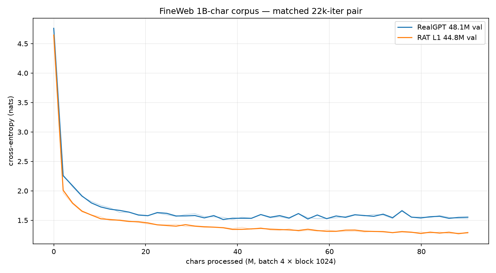

# FineWeb matched pair - final 22k result (2026-10-30)

First sized run on the 1B-char FineWeb corpus: RealGPT 48.1M vs RAT L1 44.8M,
both `batch 4 × block 1024` (4,096 chars/step), 22k iters = **90.1M chars each**,
same seed/corpus, one process per T4. This is a **loss-only** result; sample
quality and retrieval are separate, later experiments.

## Results

| arm | params | shape | steps | chars | train | **val** | bits/char | wall |
|---|---:|---|---:|---:|---:|---:|---:|---:|
| RealGPT | 48.09M | 576×12, h16 | 22k | 90.1M | 1.5262 | **1.5523** | 2.2395 | 347.8 min (5.8 h) |
| RAT L1 | 44.76M | 512×12, h64 | 22k | 90.1M | 1.2798 | **1.2911** | 1.8627 | 552.4 min (9.2 h) |

- RAT is **−0.2612 nats / −0.377 bits/char (−16.8 %)** at matched tokens, with
  **7 % fewer parameters**.
- At equal **wall-clock** (~5.8 h) RealGPT is at 22k steps / val 1.5523 while RAT
  is only at 13.5k steps / val 1.3474 - RAT is also ahead there, despite being
  ~1.6× slower per step.
- The result is the **opposite of the shakespeare overfitting** pattern: on a
  1B-char corpus RAT does not degrade at 22k and is still improving.

Raw curves: [`fineweb_22k_loss.csv`](../assets/curves/fineweb_22k_loss.csv).

## Setup and provenance

- Data: `HuggingFaceFW/fineweb` `sample-10BT` at pinned revision, ODC-By 1.0;
  ASCII-96 char vocab; document-hash split; 980.2M train / 19.8M val chars.
- RealGPT: `notebooks/fineweb_run` pair kernel (5.8 h), checkpoint/log saved.
- RAT: `notebooks/fineweb_rat22k` recovery kernel (9.2 h) after the pair
  notebook's summary cell crashed on a log-path typo; training was healthy.
  The pair-runner bug is fixed.
- Both: AdamW, lr 3e-4, wd 0.01, dropout 0.1, eval every 500 / 50 iters,
  `device: cuda`, one T4 each. No MLflow in the Kaggle kernels; metrics parsed
  from console logs. 1B-char prep: `pavelburda/tardits-fineweb-prep`.

## Caveats

- **Single seed, single eval point per step, loss only.** No quality samples,
  no NIAH/retrieval, no downstream eval; char-level, 45M params, 22k iters
  (not compute-optimal for either arm). The RAT-vs-RealGPT parameter match is
  7 %, not exact; a 560×12/h14 ≈45.3M RealGPT ablation is the clean follow-up.
- RAT is ~1.6× slower per iteration, so the equal-token result is not an
  equal-GPU-time result; both comparisons are reported above.
- RAT's advantage here is a **training-loss** result. The dagoRAT denoiser
  experience (lower loss, worse CRPS/coverage) is the warning that loss does
  not automatically transfer to sample quality.
- The 13.5k RAT checkpoint from the first pair run was trained with the
  pre-#23 scan; the clean 22k recovery checkpoint is the one reported here
  (all `|gamma| ≤ 0.9995`, no layer-2 amplification).
- No `--resume`: this is one uninterrupted 22k run per arm. Larger campaigns
  need resume (#25).

## Follow-up

- [RAT at 70 % of RealGPT](2026-10-30-fineweb-rat33m.md): 33.37M params, two
  seeds, val **1.2540 / 1.2902** (mean 1.2721), −0.404 bits/char vs RealGPT on
  average; tied with the 44.8M RAT within seed noise. This is the current
  parameter-efficiency anchor.

## Next

- ~~RAT2 pre-flight re-run on this #23-clean checkpoint~~ - **done 2026-10-30** on this
  checkpoint and the 33M one: the RAT2 post-mortem (research tree)
  §10. Verdict: one-packet capacity, retrieval null; the RAT2 track is stopped. The probe
  is kept as [`findings/rat-state-probe.md`](../findings/rat-state-probe.md).
- Sample/quality comparison, NIAH on the pair, exact-parameter RealGPT
  ablation, and 30k/60k with resume.
- Paper/report material: this replaces the shakespeare “RAT overfits” story as
  the main quality result; shakespeare stays the README demo.
