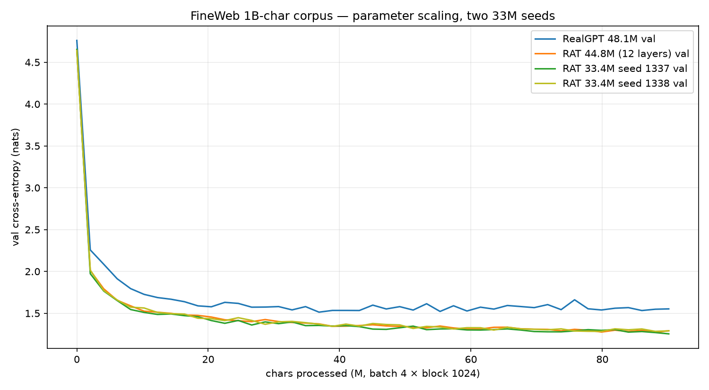

# FineWeb - RAT at 70 % of RealGPT (2 seeds, 2026-10-31)

Follow-up to the matched 22k pair: can RAT keep its val-rate with only **70 % of
RealGPT's parameters**, and does the smaller model catch RealGPT in wall-clock?
Two seeds, loss only; same corpus, batch 4 × block 1024, 22k iters / 90.1M chars.
Both 33M runs are from the pre-gamma-cap snapshot; seed 1337 has one over-unit
channel, seed 1338 does not (see caveats).

## Results

| arm | params | % RealGPT | shape | train | **val** | bits/char | wall |
|---|---:|---:|---|---:|---:|---:|---:|
| RealGPT | 48.09M | 100 % | 576×12 h16 | 1.5262 | 1.5523 | 2.2395 | 5.80 h |
| RAT L1 | 44.43M | 92.4 % | 512×12 h64 | 1.2798 | 1.2911 | 1.8627 | 9.21 h |
| RAT L1 70 %, seed 1337 | 33.37M | 69.4 % | 512×9 h64 | 1.2763 | 1.2540 | 1.8091 | 7.05 h |
| RAT L1 70 %, seed 1338 | 33.37M | 69.4 % | 512×9 h64 | 1.3033 | 1.2902 | 1.8614 | 6.92 h |
| **RAT 33M mean (2 seeds)** | **33.37M** | **69.4 %** | 512×9 h64 | - | **1.2721** | **1.8353** | 6.98 h |

At matched 90.1M chars:

- The 33M RAT is **−0.2802 nats / −0.404 bits/char (−18.1 %)** better than
  RealGPT on the 2-seed mean, with **30.6 % fewer parameters**; both seeds beat
  RealGPT by ≥0.26 nats.
- The 33M is **statistically indistinguishable from the 44M RAT** on this
  sample: 44M 1.2911; 33M seeds 1.2540 / 1.2902; mean 1.2721. The seed spread is
  **0.036 nats**, so the earlier “slightly better than 44M” was seed noise. The
  defensible claim is **no quality tax at 70 %**.
- The 33M is **~23 % faster per iteration** than the 44M (7.05 h vs 9.21 h for
  22k), but still **~1.2× RealGPT's wall-clock**.

**Equal-wall-clock view (~5.8 h, RealGPT's finish):** seed 1337 is at ~18.1k/22k
steps, val ≈1.278; seed 1338 is at ~18.4k steps, val ≈1.29–1.31. Both are already
below RealGPT's final 1.5523. The smaller RAT catches RealGPT time-wise.

Raw curves: [`fineweb_param_scaling.csv`](../assets/curves/fineweb_param_scaling.csv).

## Caveats

- **Two seeds, single val point per step, loss only.** The 0.036-nat seed spread
  is larger than the 0.037-nat 33M-vs-44M gap, so rank the 33M/44M arms as tied,
  not ordered. The RealGPT gap is ~7–8× the seed spread.
- Depth (12→9) is the only shape change; depth vs width is not separated.
  Equal-token is not equal-compute: the 33M is both smaller and faster.
- **Gamma audit:** seed 1337 has one channel at `|gamma| = 1.00099` (layer 2);
  seed 1338 has `max |gamma| = 0.99815`, no over-unit channel. Both ran from the
  pre-cap snapshot; the trainer now projects `|gamma| ≤ 1` (#27). Clamp/repair
  before long-context use.
- No sample-quality/NIAH eval; char-level; 45M-class models; no resume.

## Follow-up

- [RAT 22M / 11M width scaling](2026-10-31-fineweb-rat22m11m.md): the 11.2M
  model reaches 1.2684 (inside the 33M seed range) on one seed; 22M is worse
  (1.3038), so the floor is at most ~11M and the 22M point needs a seed replica.

## Read

RAT does **not** need 48M parameters to beat the 48M RealGPT on this corpus at
this budget. The 33.4M point is **not worse** than the 44.8M RAT within seed
noise, and is cheaper/faster; 70 % is the new parameter-efficiency anchor. The
“smaller is better” reading is not supported by two seeds.

Still to do: an exact-parameter RealGPT (~45.3M) ablation, sample-quality/NIAH
on the 33M checkpoints, and a third seed only if the 33M-vs-44M ordering
actually matters (it does not for the no-tax claim).

## Saved log / sample artifact

The seed-1337 console log is archived as
[`2026-10-30-fineweb-rat33m.log`](2026-10-30-fineweb-rat33m.log). It includes the
500-token `TESTRUN`; this is an **unaligned char-level base model**, not a
content-filtered or instruction-tuned model, so the sample is a
curiosity/artifact, not a claim or stance. The line that made the operator laugh
is preserved there for the record.

## Provenance

- Kernels: `pavelburda/tardits-fineweb-rat33m` (seed 1337,
  `wall_s=25404.2`), `pavelburda/tardits-fineweb-rat33m-s1338` (seed 1338,
  `wall_s=24929.1`), both `exit=0`.
- Configs: `experiments/configs/fineweb/rat_l1_33m.yaml`,
  `..._s1338.yaml`; commits `7da34aa`, `a52bd44`.
- Data: same 1B-char FineWeb sample-10BT prep as the pair; ASCII-96; 90.1M
  training chars consumed.
