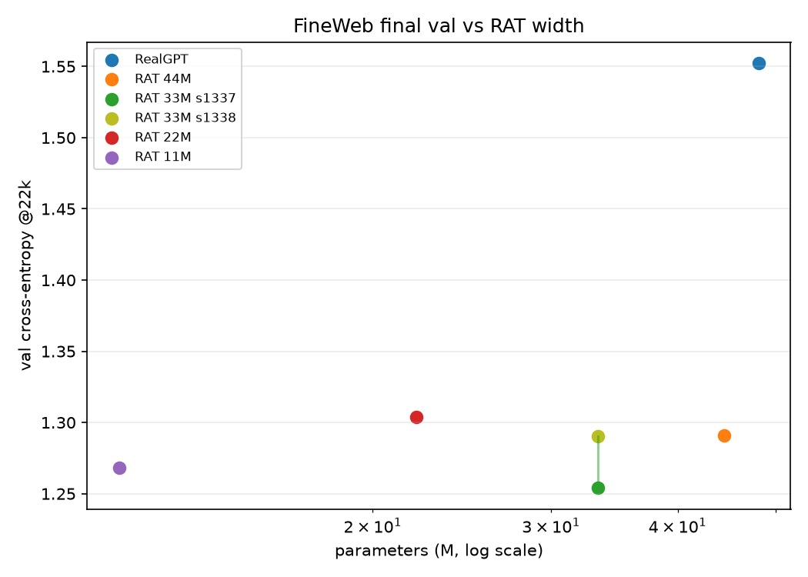

# FineWeb - RAT width scaling: 22M and 11M (2026-10-31)

Follow-up to the 33M / 44M / 48M arms: keep depth fixed at 9 layers and shrink
**width** (`n_embd`) to find where RAT's val curve stops being comparable. Both
runs: same 22k iters / 90.1M chars / batch 4 × block 1024 / seed 1337, one T4
each, launched in parallel in one 2×T4 session.

## Results

| arm | params | % RealGPT | shape | train | **val** | bits/char | wall |
|---|---:|---:|---|---:|---:|---:|---:|
| RealGPT | 48.09M | 100 % | 576×12 h16 | 1.5262 | 1.5523 | 2.2395 | 5.80 h |
| RAT 44M | 44.43M | 92.4 % | 512×12 h64 | 1.2798 | 1.2911 | 1.8627 | 9.21 h |
| RAT 33M s1337 | 33.37M | 69.4 % | 512×9 h64 | 1.2763 | 1.2540 | 1.8091 | 7.05 h |
| RAT 33M s1338 | 33.37M | 69.4 % | 512×9 h64 | 1.3033 | 1.2902 | 1.8614 | 6.92 h |
| **RAT 22M** | **22.09M** | **45.9 %** | **416×9 h52** | 1.3036 | **1.3038** | 1.8810 | 5.48 h |
| **RAT 11M** | **11.24M** | **23.4 %** | **296×9 h37** | 1.3112 | **1.2684** | 1.8299 | 3.91 h |
| RealGPT 11M | 11.13M | 23.1 % | 320×9 h8 | 1.3046 | **1.2903** | 1.8615 | 2.04 h |
| RAT 6.5M | 6.47M | 13.5 % | 224×9 h28 | 1.3571 | **1.3669** | 1.9720 | 3.08 h |

Raw curves: [`fineweb_width_scaling.csv`](../assets/curves/fineweb_width_scaling.csv).

## Reading

- **11.2M is surprisingly competitive.** Its val 1.2684 is inside the 33M seed
  range (1.2540–1.2902), essentially tied with the 44M RAT (1.2911), and
  **−0.284 nats / −0.410 bits/char (−18.3 %)** vs RealGPT - at **23.4 % of
  RealGPT's parameters** and 3.91 h.
- **The 11M RealGPT control is 1.2903.** RAT 11M is 0.022 nats ahead, i.e.
  architecture parity within one-seed noise; the 11M Real is the NIAH control.
- **6.47M RAT degrades to 1.3669** (+0.098 nats vs 11M RAT, +0.077 vs 11M
  Real), still −0.267 bits/char vs RealGPT. The width floor is therefore between
  6.5M and 11.2M on this seed; 6.5M is a useful micro checkpoint, not yet a
  quality-preserving one.
- **22M is worse than 11M**, which is not a scaling law. It is a single-seed
  anomaly (or a width/optimization effect: 416×9 h52 vs 296×9 h37, same lr/wd
  tuned for the 45M model). The 0.035-nat 22M-vs-11M gap is the same size as the
  33M seed spread; do not fit a curve through these two points yet.
- **The comparable-val floor is at most ~11M on this seed**, not 22M/33M. To
  claim it, rerun 11M and 22M with at least one more seed (and perhaps a
  width-aware lr). The 11M result is strong but single-seed.
- **Wall-clock:** 11M trains in 3.91 h, 22M in 5.48 h (parallel session wall
  5.48 h). Both are faster than RealGPT's 5.80 h; 11M is ~1.5× faster than the
  22M and ~2.4× faster than the 33M.
- Both checkpoints have **no over-unit gamma channel** (`max |gamma|` 0.9988 /
  0.9956); they ran from the pre-cap snapshot but did not trigger #27.

## Caveats

- **One seed each for 11M/22M/6.5M.** The 22M-inversion and the 11M-RAT/Real
  near-tie make seed replication necessary before drawing a width-scaling law
  or an architecture claim.
- Width is the only shape change (depth 9, head size 8); depth/width trade-offs
  are not separated. Same lr/wd for all sizes.
- Loss only; no sample-quality/NIAH. The kernel logs include 500-token TESTRUNs.
- 22k iters / 90.1M chars may be too short for the smaller models to saturate;
  their curves were still moving at the end.
- Char-level, 1B-char FineWeb, single val slice.

## Next

- **NIAH** on the new checkpoints: 11M Real control, 11M RAT, 6.47M RAT; then
  22M/33M/44M/48M for context.
- Seed replicas for 11M/22M/6.5M after NIAH, only where the result matters.
- Sample quality before any “chat model” reading; loss≠quality.

## Provenance

- Kernels: `pavelburda/tardits-fineweb-rat22m11m` (22M/11M) and
  `pavelburda/tardits-fineweb-real11m-rat6m` (11M Real / 6.5M RAT); configs
  `experiments/configs/fineweb/{rat_l1_22m,rat_l1_11m,real_11m,rat_l1_6m}.yaml`;
  commits `5ed7ccc`, `0609bd2`.
- Session wall 5.48 h; individual training walls 5.48 h / 3.91 h.
- Data: same 1B-char FineWeb sample-10BT prep; ASCII-96; 90.1M train chars.
