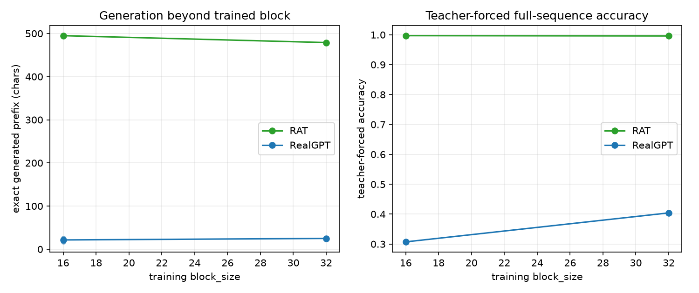

# Tiny memorization / generation-stability probe (2026-11-04, CPU)

A cheap CPU test of RAT vs RealGPT **beyond their trained block size**. One fixed
non-periodic random-ASCII text (512 chars) is used; models are trained on random
windows of length `L_train` (16/32) until they overfit the local mapping, then
asked to reproduce the whole text from a short prefix.

## Setup

- Text: 512 random printable ASCII chars, deterministic seed; no meaningful
  periodicity.
- Models: RAT L1 (`n_embd=64`, 2 layers, h8, 143k params) and RealGPT
  (`n_embd=64`, 2 layers, h8, 111k params).
- Training: random 16/32-char windows, batch 32, 3,000 AdamW steps, lr 1e-3,
  seed 0/1. Train next-char accuracy ~0.95/0.97 - not fully memorized, but
  enough for the comparison.
- **Teacher-forced**: the model is given the correct prefix at every position;
  we collect per-position logits/accuracy. No generation error accumulates.
- **Free generation**: prompt = first `L_train` chars; greedy; compare to the
  known target text; report longest exact prefix / first mismatch.
- RealGPT generation uses `generate_cached` (KV cache enabled); RAT uses its
  recurrent state. That asymmetry is inherent to the architectures and is part
  of what the test measures.

## Results

| arch | L_train | params | train acc | teacher-forced acc | exact generated prefix |
|---|---:|---:|---:|---:|---:|
| RAT | 16 | 143k | 0.948 | **0.998 / 0.996** | **495 / 495** |
| RealGPT | 16 | 111k | 0.949 | 0.315 / 0.299 | 26 / 17 |
| RAT | 32 | 143k | 0.974 | **0.996 / 0.996** | **479 / 479** |
| RealGPT | 32 | 111k | 0.974 | 0.411 / 0.397 | 26 / 24 |

Text length is 512; “exact generated prefix” is the number of consecutive target
chars reproduced after the prompt. RAT reproduces essentially the **entire**
remaining text from a 16/32-char prompt. RealGPT fails shortly after the trained
block.

Raw CSV: [`memorize_64_3k.csv`](../assets/curves/memorize_64_3k.csv).

## Reading

- This is **relative-position generalisation**, not “RAT has no position”.
  RAT's positional encoding *is* the complex decay:
  `γ^{t−s} = r^{t−s} · e^{iθ(t−s)}` - magnitude is the memory horizon, phase is
  relative position. There is no separate absolute embedding; GyRoPE is
  deliberately disabled because at level 1 its q/k phase folds into γ
  (`γ → γ·e^{iφ_k}`), i.e. it is redundant, not a missing component.
- RealGPT's RoPE is tied to absolute trained positions 0..L_train−1; beyond
  that the attention positions are OOD, and the KV cache cannot rescue it.
- The result is still useful: it shows the RAT recurrence learns a **stable
  transition rule** for this sequence, while RealGPT’s position representation
  breaks almost immediately outside the window.
- Bigger is not automatically better: a 96-wide RAT at 1k steps underfit
  (teacher-forced 0.58 at block 16) while the 64-wide one was 0.998. The size
  limit is optimization/capacity, not “more params always overfit”.
- Caveats: one text, one architecture per family, 2 seeds, 3k steps, random
  synthetic text; not a general long-context or quality claim.

## Block 64 / 128 (text length 1024)

| arch | block | teacher-forced acc | exact generated prefix |
|---|---:|---:|---:|
| RAT | 64 | 0.998 / 0.998 | **959 / 959** (of 960) |
| RealGPT | 64 | 0.361 / 0.341 | 58 / 54 |
| RAT | 128 | 0.999 / 0.998 | **895 / 895** (of 896) |
| RealGPT | 128 | 0.458 | 71 |

RAT still reconstructs the whole sequence from a 64/128-char prompt; it does not
develop a trained-block boundary. RealGPT fails near/beyond its block. One
RealGPT block-128 seed did not finish before the 3600 s CPU cap; the table keeps
what completed. Raw rows: [`memorize_blocks.csv`](../assets/curves/memorize_blocks.csv).

## Positional note (not a porting gap)

RealGPT's **classical RoPE is intentional**: the trainable GyRoPE-real was a
development prototype, stashed during the RoPE experiments and never shipped;
the final `real.py` uses the correct classical implementation. So the Real arm
here is the intended RealGPT, not a model with a missing GyRoPE.
(Trainable GyRoPE matched classical RoPE in the old experiments; it was not a
regression candidate.) RAT's position is the complex decay itself; this test is
therefore **relative complex decay vs classical RoPE**, not “RAT has position
and Real does not”.

## Next

- Repeat at L_train 64/128 and with a fully overfit criterion (train acc ≥0.999).
- A RealGPT trained at block 512 should recover full-sequence teacher-forced
  accuracy; that would confirm the failure is RoPE extrapolation rather than
  capacity.
- The structural ablation worth doing is **real-valued decay + GyRoPE** (the
  pre-RAT/HyperFormer-like model) versus **complex decay** - not “add GyRoPE to
  RAT”. At level 1 the latter is a redundant reparameterisation; at level ≥2 it
  changes the algebra and would conflate two things.
- A classical-vs-trainable-GyRoPE Real ablation remains an optional historical
  experiment, but it is not a porting fix and the old result was “matched, not
  better”.
