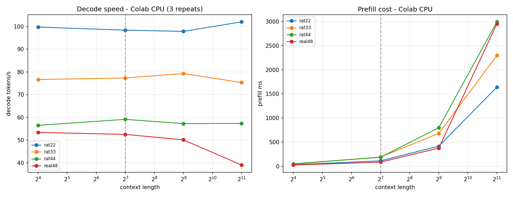

# Big-model generation speed: T4 vs Colab CPU (2026-11-08)

Same `benchmarks/bench_inference.py`, same checkpoints, batch 1, top-k sampling,
16 new tokens. RealGPT uses the KV cache; RAT uses the chunked prefill/recurrent
step path. Decode timing excludes prefill. Isolated runs: one model per process,
12 repeats on T4, 3 repeats on CPU.

## Decode speed (tokens/s)

| model | T4 @16 | T4 @2048 | T4 @4096 | CPU @16 | CPU @512 | CPU @2048 |
|---|---:|---:|---:|---:|---:|---:|
| RAT22 | 97.2 | 99.6 | 100.3 | 99.8 | 97.9 | **102.1** |
| RAT33 | 102.0 | 101.9 | 101.8 | 76.7 | 79.3 | 75.3 |
| RAT33 rerun | 95.9 | 98.2 | 99.6 | - | - | - |
| RAT44 | 76.5 | 76.5 | 77.1 | 56.5 | 57.2 | 57.3 |
| Real48 | 96.4 | 95.7 | 96.3 | 53.4 | 50.1 | **39.0** |

## Prefill (seconds)

| model | T4 @4096 | CPU @2048 |
|---|---:|---:|
| RAT22 | 0.476 | 1.640 |
| RAT33 | 0.486 | 2.297 |
| RAT44 | 0.613 | 2.994 |
| Real48 | 0.553 | 2.952 |

## Reading

- **The earlier RAT33 dip was noise.** Isolated 12-repeat runs are flat:
  102.0 at 16 -> 101.8 at 4096; the rerun agrees within ~2-3 tok/s.
- **CPU is where RAT's O(1) decode shows.** Real48 falls 53 -> 39 tok/s from
  16 -> 2048, while RAT22 stays ~100. At 2048 RAT22 is ~2.6x Real48, RAT33 ~1.9x,
  RAT44 ~1.5x.
- **RAT22 is the CPU speed winner**, not RAT33: fewer layers/heads and a narrower
  state; RAT33 is the quality winner. RAT44 pays for depth.
- **On a single T4 at batch 1, the asymptotic advantage is invisible.** RAT22/33
  and Real48 all sit around 96-102 tok/s; RAT44 is slower (~77) because of its 12
  layers. This is launch/underutilization, not a contradiction of O(1).
- Prefill is the opposite trade-off: Real48 is efficient on T4, while RAT's
  complex state scan is expensive. At 2048 CPU, RAT22 (1.64 s) still beats Real48
  (2.95 s), but RAT33/44 are close to or slower than Real.
- These are **single-stream latency** numbers. A batch-size/throughput run is
  required before making any "RAT is faster" headline.

## Context

Quality checkpoints used here: RAT33 3e-4 22k val 1.2540 (seed1337), RAT22 3e-4
22k 1.3038, RAT44 1e-4 26.5k 1.2675, Real48 1e-4 36k 1.2485. Speed and quality
are separate; do not collapse them into one summary.

## Batch throughput (T4)

Throughput = `batch * new_tokens / decode_seconds`; one model per process, 3
repeats, 16 new tokens. Peak memory is measured per run.

| model | B | L=128 | L=512 | L=2048 | peak GB @2048 |
|---|---:|---:|---:|---:|---:|
| RAT22 | 4 | 393 | 341 | 314 | 0.29 |
| RAT33 | 4 | 390 | 381 | 386 | 0.38 |
| RAT44 | 4 | 303 | 304 | 305 | 0.42 |
| Real48 | 4 | 376 | 366 | 369 | 1.86 |
| **RAT22** | **8** | 608 | 784 | **782** | 0.48 |
| **RAT33** | **8** | 795 | 779 | 624 | 0.62 |
| RAT44 | 8 | 617 | 615 | 621 | 0.66 |
| **Real48** | **8** | 744 | 757 | **487** | 3.43 |

- At **B=8 / 2048**, RAT22 is the throughput winner: **782 tok/s** vs Real48
  **487**. RAT33/44 sit around 620. That is the asymptotic effect we were
  looking for.
- At **short context / B=8**, Real48 is still competitive (744 at 128); the RAT
  advantage appears as context grows and the KV-cache work accumulates.
- RAT22 is both the CPU and T4 throughput winner, but it is the **weaker quality
  model** (1.3038 vs RAT33 1.2540). RAT33 is the quality/throughput compromise;
  RAT44 pays for depth.
- The B=8/2048 RAT33 drop (624 vs ~780) is larger than the other RAT points and
  should be treated as possibly noisy until repeated; RAT22/44 are flat there.
- Memory is not a constraint: peak 3.43 GB for Real48 at B=8/2048, well inside
  16 GB.

## Plots

