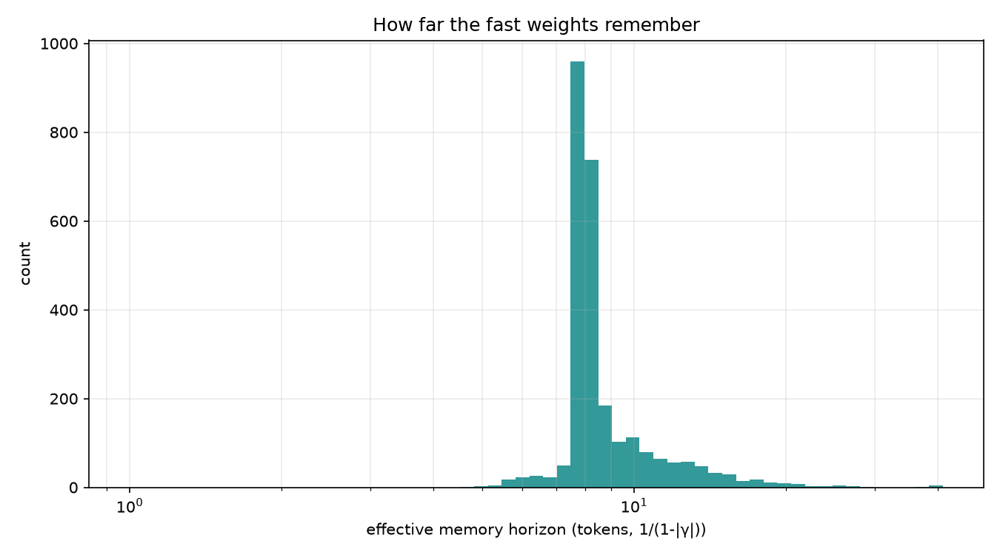
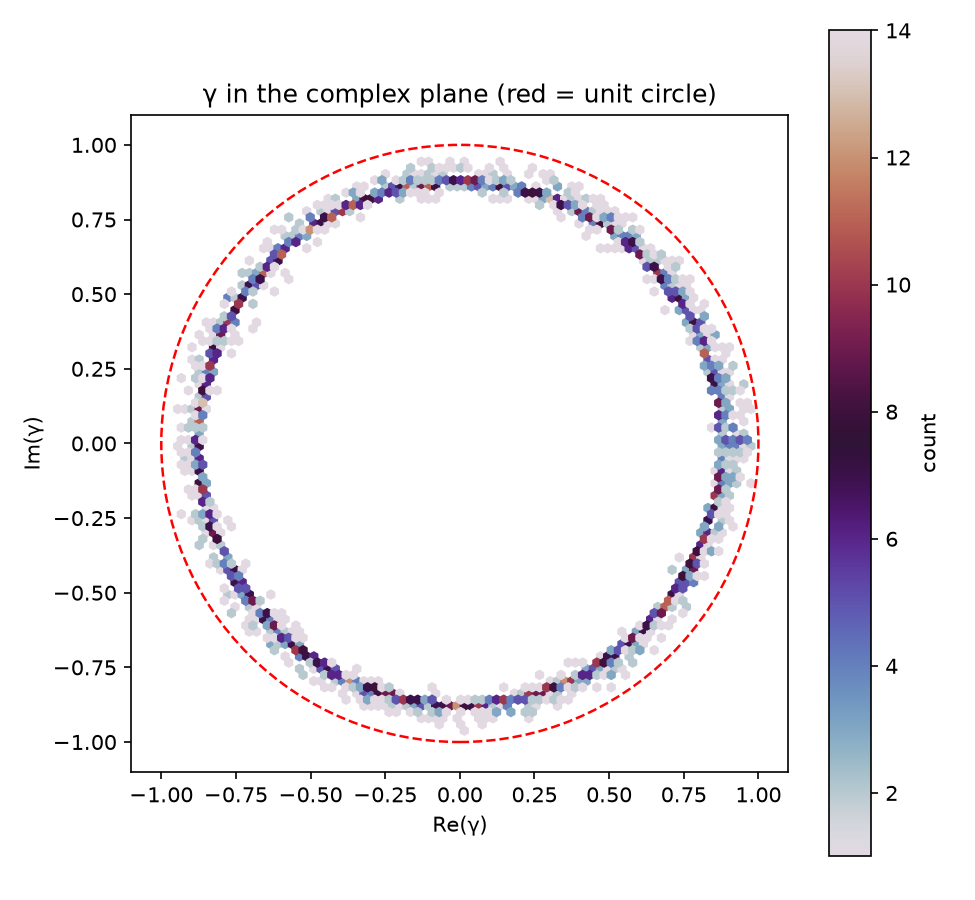

# RAT decay notes - reading `gamma`

RAT replaces softmax attention with a fast-weight memory. Every memory element has its
own complex decay:

```
S_t = S_{t-1} ⊗ γ + v_t ⊗ k̄_t
out_t = (S_t ⊗ q_t) · scale
```

`γ` is a learned parameter, initialised on the unit hypersphere. Its magnitude is the
per-token retention factor: `|γ| < 1` forgets, `|γ| ≈ 1` holds, `|γ| > 1` amplifies.
The phase of `γ` rotates the stored key/value association in the complex plane.

For a checkpoint-wide audit (decay horizon, max `|γ|`, channels `> 1`, readout history
share, state-delta capacity) use [`rat-state-probe.md`](rat-state-probe.md) /
`experiments/rat2/` (research tree).

## Why this is interesting

- **Learned memory horizons.** `1 / (1 - |γ|)` is the number of tokens after which a
  fast-weight element has decayed to ~1/e. The distribution of that horizon says how far
  back each head looks - something a softmax attention map makes hard to read.
- **Layer specialisation.** Early layers may prefer short horizons, deep layers long
  ones (or vice versa). The layer-wise mean-|γ| heatmap logs this per eval step.
- **Stability.** `|γ| > 1` is a gain/explosion risk. The fraction above 1.0 per layer is
  logged; the histogram has the 1.0 threshold marked.
- **Parameter efficiency.** A RAT block stores `[n_head, head_size, head_size]` decay
  values plus the same projections as attention; the memory is the state, not a learned
  weight matrix.

## Generated views

`docs/scripts/analyze_gamma.py --checkpoint <...>` writes:

| file | view |
|---|---|
| `assets/gamma/gamma_layers.png` | per-layer mean `|γ|` ± std and `% |γ| > 1` |
| `assets/gamma/gamma_horizon.png` | effective memory horizon distribution (log tokens) |
| `assets/gamma/gamma_complex_plane.png` | density of `γ` in the complex plane, unit circle marked |
| `assets/gamma/gamma_stats.csv` | numeric per-layer summary |

The logger also writes a 2×2 per-eval figure (Re, Im, `|γ|`, complex-plane density) to
the MLflow run under `gamma_histograms/`; `docs/scripts/make_videos.sh` turns that PNG
sequence into `assets/gamma/gamma_evolution.mp4`.

## What to look for

- A broad `|γ|` distribution below 1.0 → many different horizons, not one global decay.
- Deep layers with `|γ|` closer to 1.0 → longer-lived memory; early layers shorter.
- A small fraction above 1.0 is not automatically bad (gain can compensate for small
  keys/values), but a growing tail is a stability warning.
- The complex-plane density should sit on/near the unit circle; phases spread around the
  circle mean the memory rotates rather than only decays.

## Results - final L1 (h21, 5k)

`docs/assets/gamma/gamma_stats.csv`, final checkpoint
`examples/saved/shakespeare/rat_l1_h21_5k.pt`:

| layer | mean \|γ\| | median horizon (tokens) | share > 1 |
|---:|---:|---:|---:|
| 0 | 0.884 | 8.4 | 0% |
| 1 | **0.919** | **12.7** | 0% |
| 2 | 0.892 | 9.0 | 0% |
| 3 | 0.876 | 8.0 | 0% |
| 4 | 0.876 | 8.0 | 0% |
| 5 | 0.874 | 7.9 | 0% |
| 6 | 0.873 | 7.8 | 0% |
| 7 | 0.873 | 7.9 | 0% |





Observations:

- **The model learns to forget.** At step 1k the means were ~0.96–0.98; by 5k they sit at
  0.87–0.92. Training makes the fast weights shorter-lived rather than longer.
- **Layer 1 is the long-memory layer** (~13-token horizon); layers 3–7 converge to a
  similar ~8-token horizon. That is a clean, interpretable specialisation.
- **No explosion.** `frac(|γ| > 1)` is 0% in every layer at 5k; the complex-plane density
  stays inside/on the unit circle, with phases spread around it.
- The per-eval PNG sequence is in the MLflow run under `gamma_histograms/`; the MP4 is
  `docs/assets/gamma/gamma_evolution.mp4`.

This also hints at why the shakespeare RAT L1 run overfits: the learned horizons are
short (~8–13 tokens), so the model relies on local context and has spare capacity to
memorise the training split. A longer-horizon/regularised variant is the natural next
experiment (see the experiment report's L1 verdict).

## Caveats

- `1 / (1 - |γ|)` is a heuristic horizon, not an exact receptive field (the keys/values
  also scale the contribution).
- The level-1 implementation now uses the same de Moivre/prefix-scan path as L2–L3;
  the old `1/(γ^t + 1e-8)` shortcut saturated for trained `|γ|<1` and made
  `forward != step` (#23). The recurrent `step` path is the reference and the
  synthetic trained-`γ` regression test is in `tests/test_rat_equivalence.py`.
  A trained shakespeare checkpoint still shows ~3.7e-3 max logit drift at a
  128-token block from float32 scan rounding; the old path was ~1.8. Rerun the
  affected L1 experiments before quoting exact numbers.
- `γ` is per fast-weight element, not per head only; aggregate views hide that structure.
